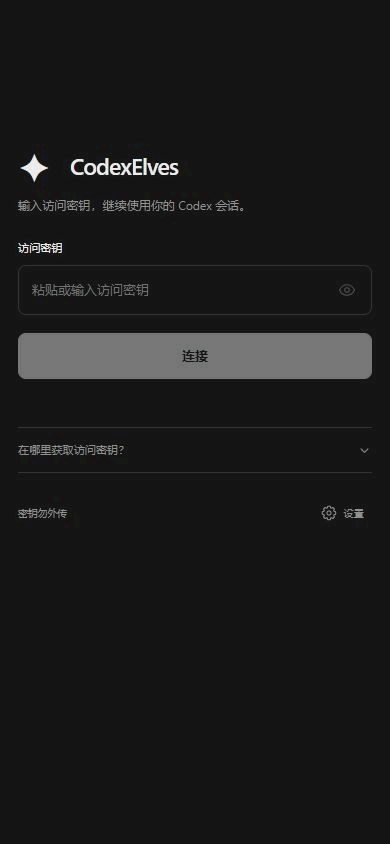
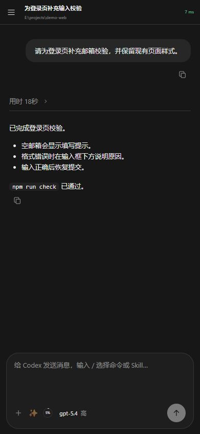
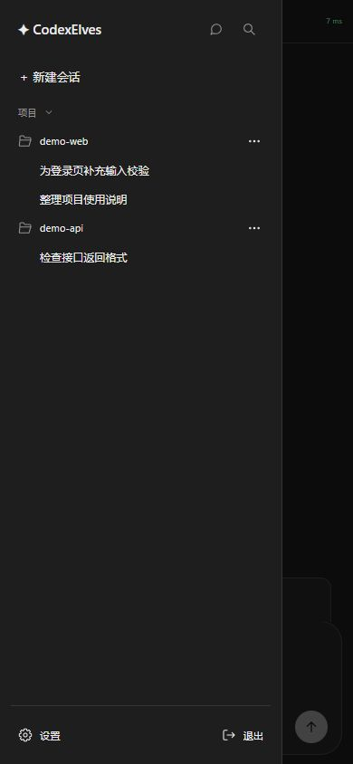
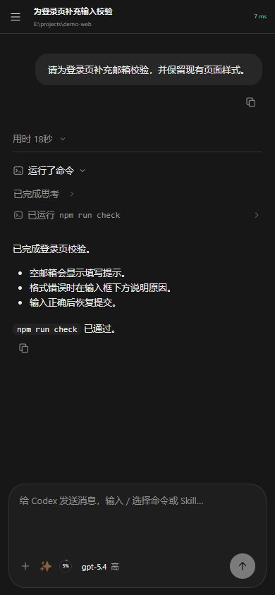
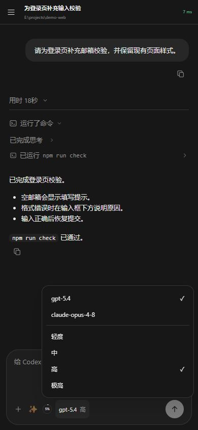
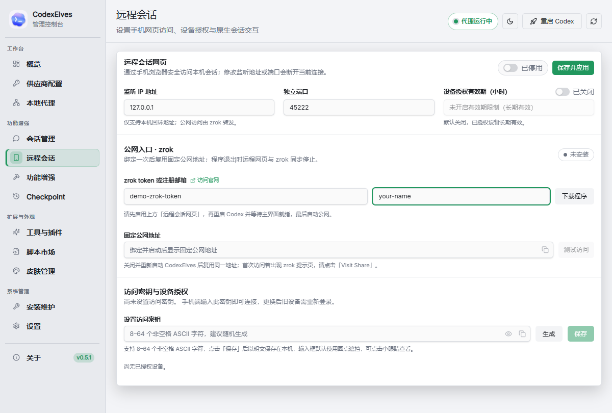
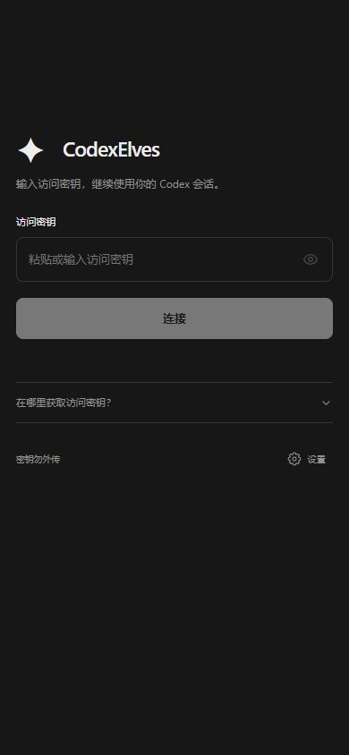

# 远程会话移动端指南

[返回项目首页](../README.md) · [效果与功能](#效果与功能) · [使用设置](#使用设置) · [连接问题](#连接问题)

在手机上查找项目、阅读执行过程、继续电脑上的 Codex 会话。任务由电脑端执行，手机和电脑共用项目与会话记录。

## 效果与功能

### 操作动图

登录 → 选择项目会话 → 展开执行记录 → 选择模型 → 输入续聊草稿。

### 会话阅读与续聊

会话页面展示提问、回复、代码块和执行耗时，消息旁的复制按钮可复制正文。底部输入框用于继续对话，输入 `/` 可查找命令或 Skill。

输入框旁还提供「＋」添加图片、压缩上下文或设置目标，**✨** 优化提示词，以及上下文用量入口；可用功能取决于电脑端服务。上下文百分比表示最近一次请求的占用比例。

### 项目与会话切换

点击左上角菜单展开侧边栏：按项目或最近会话查找记录，使用搜索定位会话，点击「新建会话」选择项目并开始新任务。项目和会话旁的菜单提供相应管理操作，底部可进入设置或退出登录。

### 执行过程查看

点击「用时」展开本轮活动，再展开命令、思考记录或工具结果，查看 Codex 做了什么。执行中可查看消息队列、停止当前任务，并处理服务支持的权限审批和问答卡片。

### 模型与思考深度

点击输入框下方的模型名称，选择模型和思考深度。模型列表来自电脑端配置；GPT 与 Claude 分别展示各自支持的深度，切换后对后续发送生效。

配图使用脱敏演示数据；[素材说明](images/showcase/README.md)记录采集方式。

## 使用设置

### 使用条件

- 电脑已安装 CodexElves，能够正常打开 Codex 桌面工作区。
- 电脑保持开机且不休眠，CodexElves 与 Codex 桌面应用持续运行。
- 手机能够访问电脑端生成的 HTTPS 公网地址。

以下 zrok 自动配置流程适用于 **Windows x64 电脑端**；macOS 暂不支持相同的内置自动下载流程。

### 1. 配置电脑端

打开 **CodexElves 管理工具 → 远程会话**，按以下顺序配置：

| 步骤 | 设置与操作 |
| --- | --- |
| 启用网页 | 打开「远程会话网页」。默认监听 `127.0.0.1:45222`；修改监听地址或端口后点击「保存并应用」 |
| 保存访问密钥 | 在「访问密钥与设备授权」点击「生成」，再点击右侧「保存」。也可自行填写 8–64 个非空格 ASCII 字符 |
| 配置公网 | 首次使用点击「下载程序」。没有 zrok 账号时，填写邮箱并点击「注册公网」，按邮件取得 token；已有 token 可直接填写 |
| 设置固定名称 | 填写 zrok token 和右侧固定公网名称。名称为 3–63 位小写字母、数字或连字符，首尾为字母或数字 |
| 连接 Codex | 点击右上角「重启 Codex」，等待管理器提示「Codex 桌面已连接」 |
| 启动公网 | 点击「启动公网」，等待状态变为「可访问」，复制「固定公网地址」；可通过「测试访问」检查入口 |

手机使用的地址为 `https://<固定公网名称>.shares.zrok.io`。邮箱或 token 在点击右侧按钮后保存，绑定后的固定名称会复用；后续使用可直接启动公网。

### 2. 连接手机

1. 在手机浏览器打开复制的 **HTTPS 公网地址**；若出现 zrok 提示页，点击「Visit Share」进入。
2. 输入电脑端已保存的**网页访问密钥**，点击「连接」。
3. 从侧边栏选择已有会话，或点击「新建会话」选择项目。

网页访问密钥用于手机登录，zrok token 用于电脑绑定公网，模型 API Key 用于请求模型，三者不能混用。

### 3. 选择访问方式

| 方式 | 如何使用 |
| --- | --- |
| 手机浏览器 | 打开固定 HTTPS 地址，输入网页访问密钥 |
| PWA | 在支持安装的浏览器中打开同一地址，通过浏览器菜单安装或添加到主屏幕 |
| Android | 从 [GitHub Releases](https://github.com/junxin367/CodexElves/releases) 的 `android-v<版本>` 发布下载 `CodexElves-<版本>-android.apk`；首次填写服务域名和网页访问密钥。要求 Android 8.0（API 26）及以上 |

三个入口共用电脑端会话和权限，均需电脑服务在线。Android APK 独立发布；没有正式 APK 时可先使用浏览器或 PWA。

### 4. 管理设备授权

在电脑端「访问密钥与设备授权」中管理手机访问：

| 操作 | 生效方式 |
| --- | --- |
| 撤销设备 | 在设备列表点击「撤销」，使该设备退出访问；需要阻止再次登录时，同时更换访问密钥 |
| 更换密钥 | 生成或填写不同的新密钥并点击「保存」，旧设备授权会撤销；只点击「生成」不会生效 |
| 限制有效期 | 开启设备授权有效期限制，填写小时数后点击「保存并应用」，对之后的新登录生效 |
| 解除登录锁定 | 连续输错超过 3 次会锁定新登录；在电脑端生成不同的新密钥并保存后重新连接 |

关闭管理器窗口默认进入托盘；从托盘退出相关程序会影响手机访问。未适配的审批、外部账号登录等操作仍需在电脑完成。

## 连接问题

| 问题 | 处理方法 |
| --- | --- |
| 打不开公网地址 | 确认电脑未休眠、相关程序仍在运行；在管理器检查 zrok 状态和「测试访问」，再核对手机网络 |
| 一直等待 Codex 就绪 | 在电脑管理器点击「重启 Codex」，等待提示「Codex 桌面已连接」后刷新手机网页 |
| 密钥错误或登录锁定 | 使用网页访问密钥；锁定时在电脑端生成不同的新密钥并保存，刷新或重启不会解锁 |
| 登录后无法读取会话 | 检查桌面连接状态，再刷新手机页面 |
| 发送后网络断开 | 恢复网络后先查看原消息与回执，确认状态后再继续操作 |
| Android 无法连接 | 核对电脑服务、公网域名和网页访问密钥 |

[远程会话技术说明](remote-access.md) · [Android 构建与运行](android.md) · [Android 与 PWA 发布说明](android-release.md)
