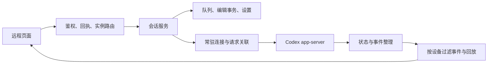

# 远程会话服务模式

## 执行范围

远程会话的 Codex 实例仅使用服务模式。网页、Windows 远程客户端和 Android 共用这一规则，不再提供运行模式开关、CDP 会话桥接、自动降级或自动切回。旧设备模式文件不再参与执行路径选择，已有设备授权、会话权限、回执和草稿继续保留。

后台管理协议为 7，避免启动时复用仍包含 Codex App IPC 路由的旧后台。源码变更需要更新远程服务后生效；仅更新网页资源或编译安装包不能替代正式服务更新。

Codex 的读取和写入统一进入 `Harness`，只使用服务独立启动的 app-server。远程功能不依赖 Codex App 运行，不连接桌面 IPC、调试端口或页面内部对象，也不转发给本地管理器代执行。本地 Codex App 增强及管理器本地会话操作保持独立，不能作为远程兜底。

服务模式提供子智能体列表、状态及只读对话查看，与侧边会话能力分别控制。子智能体读取使用 app-server 的父子关系、分页历史、已加载目录与当前连接事件，不调用 CDP，也不因查看而恢复执行或接管写入。持久化子会话支持历史分页；临时子会话只读取当前完整快照。独立引擎不支持读取临时历史时明确提示该内容无法读取，不能伪装为空历史或误报会话失效；已释放且没有可读快照时明确返回不可用并回到主会话。子智能体页不提供发送、引导、编辑或审批入口。旧后台未声明独立能力时，对应入口继续保持禁用。

### 服务模式独立侧边会话

用户选择由服务独立管理临时侧边会话，不与桌面原生侧边标签同步。主会话菜单的加号通过 `thread/fork` 创建 `ephemeral=true` 分支，继承主会话模型上下文和工作目录，聊天区只展示创建后的输入及输出。侧边会话不进入普通会话列表，也不能继续创建下一层侧边。

侧边任务边界沿用 Codex App 的方式：fork 时在当前项目已有的开发者指令后追加侧边规则，随后通过 `thread/inject_items` 写入历史边界，确认成功后才开放发送。边界前的主会话指令、计划、审批和工具记录仅供参考，侧边只处理边界后的新要求；默认回答问题和做非修改性检查，不操作已有或新建子代理，修改工作区或向其他会话发消息须由用户在边界后明确授权。边界消息不展示在聊天正文中，也不启动任务。初始化失败时释放本次临时分支，不降级为普通 fork、不重试注入；关闭结果未知时保留待核对回执，禁止向该分支发送。

创建侧边时显式继承主会话当前选中的模型和思考深度，包括尚未发送的下拉选择；若主会话权限正在保存，先等待保存成功，等待期间切换会话或授权则取消创建。权限采用远程服务为主会话保存的选择；未显式覆盖时由独立引擎的原生 fork 继承，不读取 Codex App 权限偏好。侧边保留创建结果中的批准策略、审核方式、沙盒或命名权限配置及工作区根，后续轮次沿用这份原生设置；不同侧边相互独立，主会话之后的选择不覆盖已有侧边。PC、手机及 Android 的侧边编辑区均不提供权限按钮，接口也不允许为侧边单独保存权限。无法确认原生继承权限时，创建失败并尝试释放分支。

空闲时直接发送；确认正在执行时，普通消息进入当前侧边会话的内存队列，当前任务正常完成后按顺序启动下一条。停止、失败或送达结果未知时暂停后续消息，保留手动引导、重试、编辑、删除和排序入口；明确点击“引导”及回复当前任务的询问时才使用 `turn/steer`。模型与思考深度可在执行中选择，但不写进排队消息，只在任务停止或完成后的新发送中应用；Fast 开关的作用范围和生效时机保持原有行为。名称由首条已接受的有效文字输入的前 15 个 Unicode 码点生成，不覆盖后续输入。临时侧边不提供持续目标、已发送消息编辑、置顶、持久队列或压缩期间排队发送。

正文及发送确认保存在当前服务内存中，运行中完整显示当前轮次，完成后按轮次及消息向前分页。关闭会先停止活动轮次，再取消订阅并释放临时会话；普通主会话及只读子智能体不能通过此入口关闭。重复发送复用消息标识及确认结果，结果未知时不重发。

同一服务最多同时保留 16 个侧边会话，每个正文最多 16 MiB，另有最多 100 条、合计 16 MiB 的内存待发内容；过期但未关闭的会话也计入会话数量上限，达到上限时明确拒绝对应的创建或发送，不静默截断或转为磁盘会话。引擎连接结束或会话被卸载后，临时侧边进入只读过期状态，释放尚未发送的队列，保留服务最后收到的输入及输出，仍可刷新、翻页和确认已读；不能通过 `resume` 或自动创建恢复执行。用户主动关闭时释放正文和队列；服务进程重启后内存内容无法恢复。普通网页刷新和主侧往返不会关闭仍存活的侧边。

## 执行隔离与诊断

远程执行作用域、目录预热、队列派发和事件监听固定使用服务约束。独立远程后台仍在目标发现和 WebSocket 建连前拒绝意外的 CDP 调用，防止后台任务绕过服务路径；这只是禁止旧通道的防护，不提供 CDP 功能。

服务事件流每 5 秒通过一次真实 `thread/list` 只读请求检查引擎，单次超时为 3 秒；不使用历史缓存或 `thread/resume` 作为健康依据。远程服务只处理自身的服务事件和 Claude 事件，不再轮询桌面 CDP 事件或释放旧网页注入订阅。

消息回执保留兼容字段 `nativeBridge: "harness"`，它只标识服务后端，不表示 Codex App 桥接。Codex 新操作的 `executionTransport` 为 `app-server-stdio`；历史回执中的旧通道仅作原操作证据，不再有对应执行路径。诊断记录包含请求 ID、设备、会话、实际通道、执行阶段和结果；不记录提示词、附件或凭据。队列落盘保存原请求身份，重启后派发仍可关联。仅查询已发送回执时保留原消息的通道，不把查询动作当成重新执行。

独立服务的历史首屏与单轮翻页统一展开新版 CLI 的 `{item: ...}` 包装，并兼容旧版裸历史项；网页始终直接读取消息的 `type/id`。验收检查真实助手消息及命令执行项，不能仅因历史 JSON 包含用户提示词中的预期文字就判定回复完整。

服务模式的执行中轮次会读取全部消息分页；已完成或已停止的轮次仍按需加载较早过程，但首屏补回开头的用户消息和相关展示记录，避免重开后看不到“继续”等输入。消息翻页使用 `itemCursor`，与轮次分页的 `cursor` 分开；每轮同时返回网页使用的完整性和下一页游标字段，拒绝循环游标和归属其它轮次的消息。

```powershell
.\scripts\remote-diagnostics.ps1 -Action Audit
```

该命令需要协议 7 后台，返回服务连接状态和最近 256 条执行记录。记录只包含请求 ID、实例、会话、实际服务通道、执行阶段和结果，不记录提示词、附件或凭据。

## Fast 与后续轮次

服务模式的 Fast 使用 app-server 模型目录中的 `priority` / `fast` 档位，并核对引擎账号、配置及管理员要求；不调用 CDP，不依赖桌面 Fast 注入。未知模型、非 GPT 模型、缺少 Fast 档位或账号与配置不允许时，不开放开启操作。

任务执行期间可保存本会话的 Fast 偏好。设置保存成功后，只影响之后新发起的轮次：已派发轮次及其内部后续模型调用保持原档位，`turn/steer` 不切换档位；已经入队但尚未派发的普通消息，在实际派发时读取最新偏好。关闭 Fast 时，后续轮次显式恢复 Standard，避免继承前一轮 Fast；其它明确选择的服务档位继续保留。

新会话默认关闭 Fast，仅首条创建草稿的明确选择可开启；不同会话互不继承。持久会话的偏好随服务状态保存，临时侧边会话只在当前服务内存保存。保存偏好不会启动、恢复、停止或重发任务，也不改写全局 `config.toml`；迟到的发送回执不得覆盖后来保存的 Fast 选择。

## 服务职责

网页继续使用原有 HTTP 业务接口。`RemoteAccessController` 负责设备授权、操作回执和 Codex/Claude 实例路由。`Harness` 负责会话执行、队列顺序、编辑事务、状态缓存、审批和通知；Codex app-server 是底层执行引擎。



远程服务监听成功后，异步启动隐藏的 app-server，预热会话、项目和模型目录。预热与事件监听并行，不阻塞管理器启动；失败记录诊断，后续访问继续按需重试。预热不恢复会话、不发送消息，也不改变会话写入归属。

独立接收循环处理响应、流式通知和审批请求，队列派发不能阻塞事件接收。引擎重连产生新的代次，旧连接的迟到事件不能覆盖新状态。远程服务进程退出时，其持有的 app-server 仍按既有生命周期退出；仅关闭远程客户端不停止任务。

读取会话不调用 `thread/resume`。确需写入时，由独立 app-server 恢复会话并遵守原生 writer 锁；其他进程仍持有会话时，保留原生拒绝，不能转发给持有者代执行。队列仅使用服务自己的持久状态及原生完成证据，不读取 Codex App 私有队列。停止操作只能作用于本服务已加载、能确认运行状态的会话。

已由服务持有的普通会话继续使用同一写入者，多个设备不会另建第二个运行时写入同一会话。

### 实时更新与外部会话边界

实时消息、工具、审批、状态、目标和压缩事件仅来自服务自己的 app-server 连接。其他客户端写入的持久会话可以通过原生目录和历史接口重新读取；这不提供对 Codex App 内存状态、私有审批或临时子会话的实时同步。无法读取时显示真实错误，不把缺失状态当作空闲或完成。

网页事件连接活动时，目录按既有缓存规则后台补读；目录刷新不恢复执行、不订阅桌面，也不阻塞当前消息流。服务重连后，旧代次事件不能覆盖新状态。

删除由独立引擎执行 `thread/delete`，未知结果只核对原回执。外部 writer 明确拒绝删除时，提示“该会话由其他 Codex 持有，当前无法删除。”，保留会话与草稿并解除本次删除锁定。原持有者释放后可以手动重试；官方接口 `thread/unsubscribe` [只解除当前连接自身的订阅](https://learn.chatgpt.com/docs/app-server#unsubscribe-from-a-loaded-thread)，不能让另一进程释放会话。不能用桥接、删除锁文件或强制退出其他客户端来绕过。

## 功能路径

| 功能 | 实现位置与职责 |
| --- | --- |
| 项目、会话列表、历史、模型、Skill、工作目录 | `harness/reads.rs`，统一读取并转换为现有网页的数据格式 |
| 新建、发送、停止、引导、编辑已发消息、重命名、删除 | `harness/commands.rs` 与 `harness/deletion.rs`，串行处理同一会话的写操作 |
| 排队、排序、移除、取回编辑、保存、取消、恢复 | `harness/store.rs` 与派发循环，持久保存服务队列和编辑事务 |
| 审批、权限申请、询问回答 | 保留原请求 ID 和连接代次，回答前再次核对请求身份和设备权限 |
| 目标创建、修改、暂停、恢复、删除、上下文压缩 | 服务命令处理与引擎事件同步 |
| 图片附件 | 沿用上传校验、图片注册和授权预览；编辑队列文字时保留已选择的原图 |
| 文件、Git 变更、文件预览 | 沿用现有工作区接口，通过所选后端取得工作目录 |
| 提示词优化、浏览器隧道 | 沿用已有独立服务，不增加 CDP 依赖 |
| 通知、断线重连、双线路回放 | 独立事件记录；按设备过滤定向事件，保留连续游标 |

队列保存于状态目录的 `remote-harness-state.json`。旧 `remote-access-device-runtimes.json` 不再读取，保留磁盘文件不改变执行路径。已有 HTTP 回执继续保存在原回执文件，不另建第二套请求去重规则。

进程中断时，已经派发但未确认的消息恢复为“待核对”，不能自动重发。服务只在历史中找到相同客户端消息标识的接受记录后确认成功。引擎内部错误与参数拒绝分别处理，不能把写入后的内部错误解释为“尚未发送”。

## 读取性能

### 多仓库变更

“变更”页同时读取当前项目及其子目录中的独立仓库，按仓库相对目录分组，仓库内保留已暂存、未暂存和未跟踪分区。会话位于 Git 仓库内时，以该仓库根目录为边界；非 Git 容器目录以会话工作目录为边界。支持普通 `.git` 目录以及工作树、子模块使用的 `.git` 文件。

发现子仓库时不沿用外层 `.gitignore`，避免遗漏 `sc_code` 中被外层忽略的 `core`、`web`、`svr`、`tool`、`python` 等独立仓库；每个仓库仍按自身的 Git 配置和忽略规则计算变更。依赖、构建缓存及目录联接不参与仓库发现，不扩大已有文件预览的路径边界。

列表、详情请求、缓存和历史导航均包含仓库身份，多个仓库的同名文件不会共用预览。详情直接定位所选仓库，不重复扫描整个项目。仓库失效时单独显示该仓库的读取错误，其他仓库继续返回。

发现阶段最多扫描 2 万个目录、10 万个目录项或 5 秒，最多识别 256 个仓库；变更最多并发读取 4 个仓库，共用 30 秒读取预算。单仓库保留原有 2000 项上限，整个列表最多 1 万项；达到上限或读取失败时明确显示部分结果，不把它当成完整、无变更的列表。

新版页面通过 `allRepositories: true` 请求完整格式，详情用 `repository` 指定项目内的相对仓库目录。旧页面仍接收单仓库响应；新页面连接旧后台时，仅在收到旧参数白名单拒绝后回退单仓库读取，30 秒内不重复探测旧能力。升级后的缓存格式为版本 3。

### 会话目录

首次进入或上次停在新建页时，先恢复新建标题、项目选择区和草稿，再读取侧栏。已有会话继续按原会话身份恢复缓存，后台读取结束不能覆盖用户后来选择的会话。

服务首次读取侧栏只等待最近 100 条会话，其他页由单个后台任务补齐，完成后通过事件更新页面。目录未完整时保留同一服务后端的已知展示；完整目录返回后再核对移除。热目录直接复用，每 3 秒最多补读一次首页，每 60 秒按访问触发完整核对。失败保留已有目录，5 秒内不重复尝试。新建、重命名、删除、归档和已读事件更新目录；引擎重启或读取期间发生变更时，旧代次、旧版本结果不能覆盖新状态。

项目根目录独立查询，不为读取项目文件、Skill 或创建会话遍历整个会话列表。只读请求按引擎代次、会话和参数合并，最多缓存 64 项、每项 256 KiB：会话元数据为 200ms，项目和模型配置为 30 秒，普通 Skill 读取为 5 秒。相关事件使对应缓存失效；手动刷新模型与强制扫描 Skill 会重新读取。新建前重新核对项目根目录，写入与派发前的身份校验不使用只读缓存。

项目目录合并原生 `project/list` 和同一 Codex Home 的 `.codex-global-state.json` 中明确保存的本地项目，并继承 App 的项目置顶及排列顺序。只读取项目定义、同一 Home 的 ID 映射、项目顺序和置顶列表；不读取账号、队列、审批或 App 内存状态，不建立桌面连接，不写回该文件。保留原生项目 ID，App ID 作为别名；缺少映射时仅完整根目录集合唯一匹配才去重，不按同名或单个重叠目录合并。

Codex 实例命中启用开关和当前筛选时，空项目与 App 置顶项目也必须显示。App 独有项目参与文件读取和新建选择；只有明确发送新会话时，才使用 `project/import` 按稳定幂等键登记到独立引擎。列表读取不导入项目。远程显式置顶操作保存在服务自己的状态中，App 后续更改置顶或顺序后退役旧覆盖，继续跟随 App。App 项目记录读取失败时保留同一 Home 的最近成功结果，并提示同步失败原因。

会话归属仍以原生明确的 `projectId`（包括无项目的 null）为准；仅旧引擎缺少该字段且目录唯一匹配已有项目时兼容关联，不恢复 App 私有会话迁移状态，不从会话目录创建合成项目。失效的旧缓存 ID 无法匹配时要求重新选择。新建权限和模型默认值仍只读取独立引擎的生效配置与能力要求。具体显示约定见 [产品规范](product-standards.md#远程项目视图)。

会话置顶通过 app-server 的固定置顶分区与桌面共享。侧栏独立读取置顶列表的全部分页，保留 `section_position` 顺序，再与最近目录按 ID 合并，较旧的置顶会话不受最近列表分页影响。置顶、取消置顶使用 `thread/section/move`，写入后直读确认；重复置顶不重排，取消未置顶会话不清除其自定义分区。原生分区有效时不合并服务私有旧置顶，避免已取消的置顶重新出现。只有 `threadSection/list` 明确返回方法不存在（`-32601`）才使用旧引擎兼容记录；超时、权限错误、缺少固定分区或分页异常均不能降级为空列表，全程不调用 CDP。

目标与最近一轮、模型与配置分别通过独立引擎并行读取。历史每页最多 3 轮，最多并发 3 次内容读取，仍按原轮次和消息顺序返回。侧栏只复制置顶和排序字段，避免复制包含图片、队列与历史回执的整份服务状态。连接变化时退役旧显示读取，并静默刷新模型目录。

2026-11-06 的本机 Debug 只读测量（目录尚未预热时）：首次目录请求含引擎启动约 2078ms，首批过滤后为 59 条主会话，重复读取约 7.8ms；后台约 17.97 秒补齐 173 条主会话。模型首次读取约 18.8ms、缓存命中约 1.5ms，项目工作目录约 0.13ms。

同日的启动预热测量：后台准备约 15.94 秒，随后首次读取完整的 173 条主会话约 20.3ms；派发开关仍关闭，服务没有取得任何会话的写入归属。以上均为本机后端耗时，未包含手机网络、网页渲染或安装后的真机交互。

## 验证范围

验收只使用隔离的独立 app-server、远程服务 HTTP 接口和远程页面。禁止用 Codex App 桥接、桌面代执行或历史桥接验收记录证明当前远程能力可用。

构建前通过 `node scripts/verify-windows-build-inputs.mjs . --source-only` 检查协议版本与已删除的桥接入口；该检查不代替真实功能回归。涉及不同临时密钥的后端回归使用 `--test-threads=1`，避免单条密钥缓存反复淘汰触发短时限测试。
