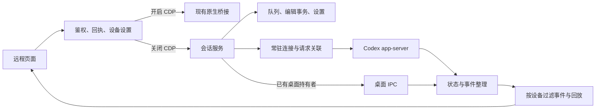

# 远程会话服务模式

## 设置范围

远程网页和 Android 网页的“设置 → 运行方式”提供“CDP 注入”开关，默认开启。

开关按**设备授权**保存。一个设备关闭后，其他设备保持原设置；同一授权下的页面会同步更新。重新授权产生新的设备标识时，使用默认开启状态。此开关控制远程请求的执行路径，不修改桌面其他注入增强的配置。

关闭后，当前设备的会话请求进入 CodexElves 常驻服务，不能在失败时回退到 CDP。设置使用版本号比较后保存，拒绝迟到的旧页面覆盖新值。前端有未确认操作或正在编辑消息时不能切换；服务模式还有本设备提交的活动任务或待发消息时，也不能直接切回。

第一期不提供侧边会话和子智能体操作。会话菜单及消息中的子智能体入口置灰，不显示说明、弹窗或提示；历史中的相关会话入口返回主会话。

## 服务职责

网页继续使用原有 HTTP 业务接口。`RemoteAccessController` 负责设备授权、操作回执和后端选择。`Harness` 负责会话执行、队列顺序、编辑事务、状态缓存、审批和通知；Codex app-server 是底层执行引擎。

服务按需启动一个隐藏的 app-server 进程并复用连接。独立接收循环处理响应、流式通知和审批请求，队列派发不能阻塞事件接收。引擎重连会产生新的代次；旧连接的迟到事件不能覆盖新状态。

读取会话不会为了获取状态而调用 `thread/resume`。写入前区分当前持有者：桌面已持有的会话通过 IPC 操作；服务持有的会话通过自己的运行时操作。服务派发普通队列消息前还会检查已知桌面队列，等待桌面已有待发内容处理，不直接改写桌面队列文件。

已由服务持有的普通会话继续使用这一写入者，即使请求来自开启 CDP 的设备，也不另建第二个运行时写入同一会话。

## 功能路径

| 功能 | 实现位置与职责 |
| --- | --- |
| 项目、会话列表、历史、模型、Skill、工作目录 | `harness/reads.rs`，统一读取并转换为现有网页的数据格式 |
| 新建、发送、停止、引导、编辑已发消息、重命名、删除 | `harness/commands.rs`，串行处理同一会话的写操作 |
| 排队、排序、移除、取回编辑、保存、取消、恢复 | `harness/store.rs` 与派发循环，持久保存服务队列和编辑事务 |
| 审批、权限申请、询问回答 | 保留原请求 ID 和连接代次，回答前再次核对请求身份和设备权限 |
| 目标创建、修改、暂停、恢复、删除、上下文压缩 | 服务命令处理与引擎事件同步 |
| 图片附件 | 沿用上传校验、图片注册和授权预览；编辑队列文字时保留已选择的原图 |
| 文件、Git 变更、文件预览 | 沿用现有工作区接口，通过所选后端取得工作目录 |
| 提示词优化、浏览器隧道 | 沿用已有独立服务，不增加 CDP 依赖 |
| 通知、断线重连、双线路回放 | 独立事件记录；按设备选择后端，保留连续游标 |

队列保存于状态目录的 `remote-harness-state.json`，设备开关保存于 `remote-access-device-runtimes.json`。已有 HTTP 回执继续保存在原回执文件，不另建第二套请求去重规则。

进程中断时，已经派发但未确认的消息恢复为“待核对”，不能自动重发。服务只在历史中找到相同客户端消息标识的接受记录后确认成功。引擎内部错误与参数拒绝分别处理，不能把写入后的内部错误解释为“尚未发送”。

## GitHub 参考

以下数字由 GitHub API 于 2026-11-05 查询，后续会变化。

| 项目 | Stars | 用途 |
| --- | ---: | --- |
| `pingdotgg/t3code` | 47,521 | 主参考：服务编排、事件整理、命令回执与持久状态 |
| `Dimillian/CodexMonitor` | 4,364 | Rust 常驻进程、异步协议收发、响应与事件分离 |
| `anywhere-labs/Agents-Anywhere` | 2,792 | 补充：桌面 owner/follower 协议及单一写入者约束 |

具体参考文件：

- `https://github.com/pingdotgg/t3code/blob/337c5858c33bc7f8f6dfd391a2c279fa0f7e4d17/docs/orchestration-v2/README.md`
- `https://github.com/pingdotgg/t3code/blob/337c5858c33bc7f8f6dfd391a2c279fa0f7e4d17/apps/server/src/orchestration-v2/ProviderSessionManager.ts`
- `https://github.com/pingdotgg/t3code/blob/337c5858c33bc7f8f6dfd391a2c279fa0f7e4d17/apps/server/src/orchestration-v2/CommandReceiptStore.ts`
- `https://github.com/Dimillian/CodexMonitor/blob/dd61b9abd37de5ded86e82b9fe8a83fd49d46fa5/src-tauri/src/backend/app_server.rs`
- `https://github.com/anywhere-labs/Agents-Anywhere/blob/main/docs/codex-ipc-takeover.md`
- `https://github.com/openai/codex/blob/86ac0916597244a2e67a197822a5483924660ff1/codex-rs/app-server/src/request_processors/thread_goal_processor.rs`

实现没有引入第三方项目运行依赖。协议参数另用本机 `codex-cli 0.166.0-alpha.6` 导出的实验性 JSON Schema 核对；桌面 IPC 方法版本和参数用已安装 `26.1029.7803.0` 的代码核对。安装 REA 工具并非本次验证的必要条件。

## 验证范围

已完成本机真实 Codex 的只读握手、项目与会话列表、历史和目标读取。业务写操作使用隔离执行引擎测试，并禁止任何 CDP 调用；测试覆盖新建、队列编辑、图片保留、审批、目标控制、停止、压缩、重命名、置顶、工作区文本预览，以及接受后发生错误时的历史确认和防重发。

手机宽度的设置页、关闭后的两个置灰入口，以及第二个独立浏览器仍保持默认开启，已在隔离网页中实际点击并查看截图。

这些结果不等于已安装客户端的实机验收。尚未验证真实模型执行、真实桌面已有任务的完整接管、桌面临时队列的跨端编辑，以及 Android 原生容器中的完整交互。当前安装包若仍来自之前的 `f07921da` 构建，不包含此服务模式。

涉及不同临时密钥的后端回归使用 `--test-threads=1`。现有密钥校验缓存只保存一组材料，多套隔离夹具并发运行会反复淘汰缓存、重复执行密钥派生并触发短时限测试；本次没有改动生产鉴权逻辑。
