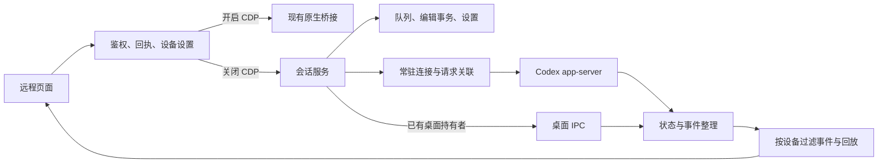

# 远程会话服务模式

## 设置范围

远程网页和 Android 网页的“设置 → 运行模式”提供模式开关，默认尝试“CDP 模式”。关闭时切换为“服务模式”，开关旁的名称同步变化；保存失败时，名称和开关一起恢复为服务端确认的模式。电脑端未注入、无法连接 CDP 或原生事件持续不可用时，按下面的自动切换规则改用服务模式。

开关按**设备授权**保存。一个设备关闭后，其他设备保持原设置；同一授权下的页面会同步更新。重新授权产生新的设备标识时，使用默认开启状态。此开关控制远程请求的执行路径，不修改桌面其他注入增强的配置。

当前桌面后台使用管理协议 5，包含服务模式的 CDP 隔离和执行诊断。新版启动时不复用缺少这些约束的旧后台；确认旧后台身份后，按既有流程更换后台，设备授权和模式配置继续保留。后台健康接口同时返回产品版本和注入构建标识，便于区分相同产品版本下的实际代码。

Windows 打包前后会核对程序内嵌的桌面注入、远程页面与原生桥是否和当前源码逐字节一致。使用共享 Cargo 目录时，其他工作树生成的同版本程序不能通过校验，避免新版 Android 页面连接缺少对应接口的旧桌面后台。

关闭后，当前设备的会话请求进入 CodexElves 常驻服务，不能在失败时回退到 CDP。设置使用版本号比较后保存，拒绝迟到的旧页面覆盖新值。前端有未确认操作或正在编辑消息时不能手动切换；服务模式还有本设备提交的活动任务或待发消息时，也不能直接切回。

### CDP 不可用时自动切换

由电脑后台的原生事件健康检查触发，覆盖未注入、无调试连接、事件探测超时或错误、无效事件响应，以及请求已退回只读服务的情况。连续异常至少 3 秒后，先启动并确认独立服务可读，等待原后端请求退出后再复核服务健康，将当前仍使用 CDP 的有效设备授权保存为服务模式。单次 CDP 探测最多等 5 秒；每次服务准备最多等 8 秒，其中实际 `thread/list` 健康检查最多等 3 秒。准备或保存失败时保留原模式，按至少 10 秒的尝试间隔重试。

自动切换复用模式版本校验和设备授权；手机断网不会作为电脑端 CDP 故障依据，已手动选择服务模式的设备不受影响，迟到的旧故障不能覆盖新的手动设置。只读和审批权限保持原样。切换成功同步设置开关并提示一次。

因 CDP 故障自动降级的设备继续进行后台只读 CDP 健康探测，原因标记随设备模式保存，服务热更新后仍可识别。CDP 连续可用至少 5 秒后，在服务模式没有活动任务、待发或结果未知的队列消息、未关闭的临时侧边及正在派发的请求时自动切回；持有模式写锁等待原请求退出后，再做一次最多 5 秒的真实 CDP 探测，成功后才保存新模式。任务未结束或准备失败时至少间隔 10 秒再尝试，不重发任何业务操作，不丢弃旧回执或草稿。

手动选择服务模式的设备不会自动切回，也不会因此启动 CDP 探测；即使再次明确选择当前服务模式，也会清除自动恢复标记并递增模式版本。恢复探测只服务于原先选择 CDP、后来自动降级的设备，不改变服务业务请求的 CDP 隔离。自动恢复成功同步开关并提示一次。

模式切换等待已派发的原后端请求退出，不把原业务操作转交另一后端重发。`pending/unknown` 回执、原请求 ID 和未提交草稿继续保留；页面只取消旧读取并刷新新后端。原 CDP 侧边会话仍留在桌面，远程页返回主会话，不将其转换为服务侧边会话。

服务模式提供子智能体列表、状态及只读对话查看，与侧边会话能力分别控制。子智能体读取使用 app-server 的父子关系、分页历史、已加载目录与当前连接事件，以及桌面持有者的只读 IPC 快照，不调用 CDP，也不因查看而恢复执行或接管写入。持久化子会话支持历史分页；临时子会话只读取当前完整快照。引擎不支持读取临时历史且桌面没有快照时提示在桌面查看，不能伪装为空历史或误报会话失效；已释放且没有可读快照时明确返回不可用并回到主会话。子智能体页不提供发送、引导、编辑或审批入口。旧后台未声明独立能力时，对应入口继续保持禁用。

### 服务模式独立侧边会话

用户选择由服务独立管理临时侧边会话，不与桌面原生侧边标签同步。主会话菜单的加号通过 `thread/fork` 创建 `ephemeral=true` 分支，继承主会话模型上下文和工作目录，聊天区只展示创建后的输入及输出。侧边会话不进入普通会话列表，也不能继续创建下一层侧边。

支持空闲发送、运行中补充要求（`turn/steer`）、停止、审批和询问回复、压缩及关闭。模型与思考深度按侧边自身设置读取，执行期间不切换模型，停止或完成后可修改。名称由首条有效文字输入的前 15 个 Unicode 码点生成，不覆盖后续输入。临时侧边不提供持续目标、已发送消息编辑、置顶、持久队列或压缩期间排队发送。

正文及发送确认保存在当前服务内存中，运行中完整显示当前轮次，完成后按轮次及消息向前分页。关闭会先停止活动轮次，再取消订阅并释放临时会话；普通主会话及只读子智能体不能通过此入口关闭。重复发送复用消息标识及确认结果，结果未知时不重发。

同一服务最多同时保留 16 个侧边会话，每个正文最多 16 MiB；过期但未关闭的会话也计入此上限，达到会话数量或正文上限时明确拒绝对应的创建或发送，不静默截断或转为磁盘会话。引擎连接结束或会话被卸载后，临时侧边进入只读过期状态，保留服务最后收到的输入及输出，仍可刷新、翻页和确认已读；不能通过 `resume` 或自动创建恢复执行。用户主动关闭时释放正文；服务进程重启后内存内容无法恢复。创建侧边的设备需关闭这些侧边后才能切换运行方式；普通网页刷新和主侧往返不会关闭仍存活的侧边。

## CDP 隔离与诊断

服务请求进入独立执行作用域，目录预热、队列派发、事件监听和提示词优化任务显式保留该约束。原生路由、CDP 目标发现和 WebSocket 建连均在执行前检查；嵌套作用域不能重新允许 CDP。独立远程后台还拒绝没有执行上下文的 CDP 调用，避免新建后台任务遗漏约束。桌面启动器的增强注入保留原行为，不能据此判断远程服务是否独立可用。

没有有效 CDP 设备且没有等待自动恢复的设备时不启动原生事件轮询。关闭远程访问时，只清理本后台实际启动过的原生订阅；始终手动使用服务模式的后台不会为了 `dispose` 再探测桌面。服务事件流每 5 秒通过一次真实 `thread/list` 只读请求检查引擎，单次超时为 3 秒；不使用历史缓存、CDP 状态或 `thread/resume` 作为健康依据。

消息回执保留 `nativeBridge: "harness"`，另用 `executionTransport` 区分 `app-server-stdio` 与 `desktop-ipc`。诊断记录包含请求 ID、设备、会话、模式版本、实际通道、执行阶段和结果；不记录提示词、附件或凭据。队列落盘保存原请求身份，重启后派发仍可关联。仅查询已发送回执时保留原消息的通道，不把查询动作当成重新执行。

独立服务的历史首屏与单轮翻页统一展开新版 CLI 的 `{item: ...}` 包装，并兼容旧版裸历史项；网页始终直接读取消息的 `type/id`。验收检查真实助手消息及命令执行项，不能仅因历史 JSON 包含用户提示词中的预期文字就判定回复完整。

服务模式的执行中轮次会读取全部消息分页；已完成或已停止的轮次仍按需加载较早过程，但首屏补回开头的用户消息和相关展示记录，避免重开后看不到“继续”等输入。消息翻页使用 `itemCursor`，与轮次分页的 `cursor` 分开；每轮同时返回网页使用的完整性和下一页游标字段，拒绝循环游标和归属其它轮次的消息。

```powershell
.\scripts\remote-diagnostics.ps1 -Action Execution
```

该命令需要协议 5 后台，返回当前进程的 `serviceCdpAttempts`、`processCdpEntryAttempts`、`processBlockedCdpAttempts` 和最近 256 条执行记录。服务模式的 CDP 尝试次数必须为 0；其他设备选择 CDP 时，进程总入口计数可以增加。被硬隔离拦住的错误调用也算尝试，不能把“未成功连接”误报为“没有依赖”。

## 无 CDP 验收入口

```powershell
.\scripts\remote-diagnostics.ps1 -Action VerifyService `
  -CodexExecutable '实际的 Codex CLI 可执行文件绝对路径' `
  -OutputPath '新的验收报告绝对路径.json'
```

验收使用真实 Codex app-server、独立 Codex Home、临时工作目录和本地受控 Responses 端点，不读取用户密钥，不产生外部模型费用。测试进程从启动时设置 `CODEX_ELVES_DISABLE_CDP=1`，网络入口全面拒绝 CDP；桌面 IPC 指向本轮专属且不存在的测试管道，防止借用正在运行的用户桌面。环境变量仅作用于本次测试进程，并在结束时恢复。

覆盖冷启动、新建和发送、真实流式增量、模型/项目/历史/Skill/工作目录读取、真实命令审批，以及流式执行中终止独立引擎后的队列恢复与重复发送检查。通过条件同时要求 `serviceCdpAttempts=0`、`processCdpEntryAttempts=0` 和模型请求次数符合预期。审批仅针对输出固定文字的测试命令，不批准其他请求。

该报告证明独立服务执行路径不借用 CDP 或用户桌面。桌面已有会话由 IPC 持有的场景另用 IPC 回归验证；真实桌面页面刷新、冻结及 Android 原生交互不包含在此入口中，不能据此声明完成全部客户端实机验收。IPC 故障不会被当作没有持有者，不切回 CDP；已经派发但未确认的操作保留待核对状态。

## Fast 与后续轮次

服务模式的 Fast 使用 app-server 模型目录中的 `priority` / `fast` 档位，并核对引擎账号、配置及管理员要求；不调用 CDP，不依赖桌面 Fast 注入。未知模型、非 GPT 模型、缺少 Fast 档位或账号与配置不允许时，不开放开启操作。

任务执行期间可保存本会话的 Fast 偏好。设置保存成功后，只影响之后新发起的轮次：已派发轮次及其内部后续模型调用保持原档位，`turn/steer` 不切换档位；已经入队但尚未派发的普通消息，在实际派发时读取最新偏好。关闭 Fast 时，后续轮次显式恢复 Standard，避免继承前一轮 Fast；其它明确选择的服务档位继续保留。

新会话默认关闭 Fast，仅首条创建草稿的明确选择可开启；不同会话互不继承。持久会话的偏好随服务状态保存，临时侧边会话只在当前服务内存保存。保存偏好不会启动、恢复、停止或重发任务，也不改写全局 `config.toml`；迟到的发送回执不得覆盖后来保存的 Fast 选择。

## 服务职责

网页继续使用原有 HTTP 业务接口。`RemoteAccessController` 负责设备授权、操作回执和后端选择。`Harness` 负责会话执行、队列顺序、编辑事务、状态缓存、审批和通知；Codex app-server 是底层执行引擎。



远程服务监听成功后，异步启动一个隐藏的 app-server，预热会话、项目和模型目录，即使所有设备都开启 CDP 也执行。预热与事件监听并行，不阻塞管理器启动或 CDP 请求；失败只记录诊断，后续使用服务模式时仍可按需重试。预热只读取共享元数据，不恢复会话、不发送消息、不启用队列派发，也不改变设备的运行方式。

切回 CDP 后保留预热引擎与目录，沿用后续按访问触发的缓存更新策略，不增加定时全量扫描。关闭远程服务时取消预热，释放仅用于预热的引擎；已有服务任务保持原生命周期。独立接收循环处理响应、流式通知和审批请求，队列派发不能阻塞事件接收。引擎重连会产生新的代次；旧连接的迟到事件不能覆盖新状态。

读取会话不会为了获取状态而调用 `thread/resume`。写入前区分当前持有者：桌面已持有的会话通过 IPC 操作；服务持有的会话通过自己的运行时操作。服务派发普通队列消息前还会检查已知桌面队列，等待桌面已有待发内容处理，不直接改写桌面队列文件。

已由服务持有的普通会话继续使用这一写入者，即使请求来自开启 CDP 的设备，也不另建第二个运行时写入同一会话。

### 桌面会话实时同步

服务模式通过原生桌面 IPC 观察 Codex App 中的会话。网页在新后台声明 `desktopSessionSync` 后，使用只读 `observeThreads` 接口登记当前主会话和侧栏视口内的 Codex 会话；进入关联详情时登记对应主会话。Claude、未显示的列表项及新建草稿不进入此观察列表。滚动和布局变化合并 150ms 后更新，沿用既有 15 秒连接轮询续期，不轮询整份消息正文。

多个页面或设备观察同一会话时共享一个订阅，不再用原来的 8 条限制任意淘汰会话。首份快照的连接发现最多并发 4 个，收到快照后立即释放发现名额。45 秒内未续期的非执行会话释放连接；已确认执行中的会话继续观察到完成。执行期间断线保留最多 45 秒恢复窗口，仍有页面续期时持续重连。只读观察不会调用 `thread/resume`、`turn/start`、停止或审批操作。

原生消息、工具、审批及执行状态进入同一服务端投影，并通过现有网页事件流更新正文和列表。断线只将运行状态标为未知，保留已显示正文和原发送回执；失败后等待 3 秒再发现持有者并订阅，取得快照后按原生会话、轮次和消息身份合并。连接结束前排空已收到的快照，确保最后的完成结果仍被处理。单会话恢复只触发该会话补读，历史完成记录和重复快照不产生重复完成事件。审批字段缺失时保留上次审批并标记信息尚不完整，只有明确的空数组才能确认已无待处理审批。服务执行引擎重连不会清空仍在线的桌面观察状态；服务取得执行权前取消该会话的桌面订阅。

存在可见页面的观察兴趣时，包括会话列表尚为空的页面，后台沿用 3 秒目录缓存刷新机制发现新增或更新的会话，变化后通知网页更新列表。目录刷新与消息事件接收独立，不在前台读取或发送路径逐个等待桌面连接。单次观察登记最多 128 个会话 ID，与网页采集上限保持一致；它不限制已经执行中的会话保留。页面或运行模式变化后立即退役旧观察请求，新订阅不等待旧网络请求返回；服务重启或全量重连会清除旧登记缓存，即使设备和模式版本相同也立即重新登记。

每个观察器只保留用于比较的上一份快照，事件回放历史统一由服务通道管理，不再为每个订阅额外缓存 2,048 条正文事件。差异比较跳过稳定轮次，并对已存在的消息 ID 建立索引；一次快照产生超过通道容量的变化时，由统一通道明确触发补读，不能在订阅内静默截断。队列派发同时检查原生运行摘要，摘要已明确执行中时，不因当前轮次尚未加载而提前发送下一条消息。

桌面同步需要 Codex App 运行，并提供兼容的原生 IPC 协议。实时更新粒度由原生状态推送决定；存储历史用于补齐，不作为“桌面仍在执行”或“已经停止”的证明。独立服务自身的会话继续使用其 app-server 事件流。

2026-11-13 在本机 Codex App `26.1106.6628.0` 上完成只读实测：新观察器读取到 `active`，随后 20 秒内取得 5 个映射事件，其中 4 个为消息项更新，`serviceCdpAttempts` 为 0。实测不发送模型消息、不恢复执行、不切换正式服务，临时探针已删除。断线重连、完成去重、审批投影和订阅共享由隔离测试验证；此证据不代表正式网页入口已经热更新或完成 Android 容器实机验收。

## 功能路径

| 功能 | 实现位置与职责 |
| --- | --- |
| 项目、会话列表、历史、模型、Skill、工作目录 | `harness/reads.rs`，统一读取并转换为现有网页的数据格式 |
| 新建、发送、停止、引导、编辑已发消息、重命名、删除 | `harness/commands.rs`，串行处理同一会话的写操作 |
| 排队、排序、移除、取回编辑、保存、取消、恢复 | `harness/store.rs` 与派发循环，持久保存服务队列和编辑事务 |
| 审批、权限申请、询问回答 | 保留原请求 ID 和连接代次，回答前再次核对请求身份和设备权限 |
| 目标创建、修改、暂停、恢复、删除、上下文压缩 | 服务命令处理与引擎事件同步 |
| 图片附件 | 沿用上传校验、图片注册和授权预览；编辑队列文字时保留已选择的原图 |
| 文件、Git 变更、文件预览 | 沿用现有工作区接口，通过所选后端取得工作目录 |
| 提示词优化、浏览器隧道 | 沿用已有独立服务，不增加 CDP 依赖 |
| 通知、断线重连、双线路回放 | 独立事件记录；按设备选择后端，保留连续游标 |

队列保存于状态目录的 `remote-harness-state.json`，设备开关保存于 `remote-access-device-runtimes.json`。已有 HTTP 回执继续保存在原回执文件，不另建第二套请求去重规则。

进程中断时，已经派发但未确认的消息恢复为“待核对”，不能自动重发。服务只在历史中找到相同客户端消息标识的接受记录后确认成功。引擎内部错误与参数拒绝分别处理，不能把写入后的内部错误解释为“尚未发送”。

## 读取性能

### 多仓库变更

“变更”页同时读取当前项目及其子目录中的独立仓库，按仓库相对目录分组，仓库内保留已暂存、未暂存和未跟踪分区。会话位于 Git 仓库内时，以该仓库根目录为边界；非 Git 容器目录以会话工作目录为边界。支持普通 `.git` 目录以及工作树、子模块使用的 `.git` 文件。

发现子仓库时不沿用外层 `.gitignore`，避免遗漏 `sc_code` 中被外层忽略的 `core`、`web`、`svr`、`tool`、`python` 等独立仓库；每个仓库仍按自身的 Git 配置和忽略规则计算变更。依赖、构建缓存及目录联接不参与仓库发现，不扩大已有文件预览的路径边界。

列表、详情请求、缓存和历史导航均包含仓库身份，多个仓库的同名文件不会共用预览。详情直接定位所选仓库，不重复扫描整个项目。仓库失效时单独显示该仓库的读取错误，其他仓库继续返回。

发现阶段最多扫描 2 万个目录、10 万个目录项或 5 秒，最多识别 256 个仓库；变更最多并发读取 4 个仓库，共用 30 秒读取预算。单仓库保留原有 2000 项上限，整个列表最多 1 万项；达到上限或读取失败时明确显示部分结果，不把它当成完整、无变更的列表。

新版页面通过 `allRepositories: true` 请求完整格式，详情用 `repository` 指定项目内的相对仓库目录。旧页面仍接收单仓库响应；新页面连接旧后台时，仅在收到旧参数白名单拒绝后回退单仓库读取，30 秒内不重复探测旧能力。升级后的缓存格式为版本 3。

### 会话目录

首次进入或上次停在新建页时，先恢复新建标题、项目选择区和草稿，再读取侧栏。已有会话继续按原会话身份恢复缓存，后台读取结束不能覆盖用户后来选择的会话。

服务首次读取侧栏只等待最近 100 条会话，其他页由单个后台任务补齐，完成后通过事件更新页面。目录未完整时保留同一服务后端的已知展示；完整目录返回后再核对移除。热目录直接复用，每 3 秒最多补读一次首页，每 60 秒按访问触发完整核对。失败保留已有目录，5 秒内不重复尝试。新建、重命名、删除、归档和已读事件更新目录；引擎重启或读取期间发生变更时，旧代次、旧版本结果不能覆盖新状态。

项目根目录独立查询，不为读取项目文件、Skill 或创建会话遍历整个会话列表。只读请求按引擎代次、会话和参数合并，最多缓存 64 项、每项 256 KiB：会话元数据为 200ms，项目和模型配置为 30 秒，普通 Skill 读取为 5 秒。相关事件使对应缓存失效；手动刷新模型与强制扫描 Skill 会重新读取。新建前重新核对项目根目录，写入与派发前的身份校验不使用只读缓存。

项目列表与 CDP 使用相同的已保存项目范围、桌面项目 ID、名称和顺序，置顶项目优先；不再把无项目会话、临时会话目录或工作树目录自动补成项目。桌面项目迁移尚未完成时，只读同一 Codex Home 的本机迁移映射、会话归属和明确无项目记录；迁移完成后采用引擎归属，避免旧记录覆盖后续移动。仅缺少明确归属且目录唯一匹配已有项目时兼容关联。新建时将桌面项目 ID 转回经过项目目录验证的引擎 ID。服务内明确置顶或取消置顶的选择优先于桌面初始值。桌面移动会话或移出项目后，服务目录同步更新。旧网页缓存中的合成项目会被清理，其会话仍保留；同名的真实项目继续显示路径以便区分。

会话置顶通过 app-server 的固定置顶分区与桌面共享。侧栏独立读取置顶列表的全部分页，保留 `section_position` 顺序，再与最近目录按 ID 合并，较旧的置顶会话不受最近列表分页影响。置顶、取消置顶使用 `thread/section/move`，写入后直读确认；重复置顶不重排，取消未置顶会话不清除其自定义分区。原生分区有效时不合并服务私有旧置顶，避免已取消的置顶重新出现。只有 `threadSection/list` 明确返回方法不存在（`-32601`）才使用旧引擎兼容记录；超时、权限错误、缺少固定分区或分页异常均不能降级为空列表，全程不调用 CDP。

会话元数据与桌面持有者快照、目标与最近一轮、模型与配置分别并行读取。历史每页最多 3 轮，最多并发 3 次内容读取，仍按原轮次和消息顺序返回。侧栏只复制置顶和排序字段，避免复制包含图片、队列与历史回执的整份服务状态。切换运行方式会退役旧显示读取，并静默刷新模型目录。

2026-11-06 的本机 Debug 只读测量（目录尚未预热时）：首次目录请求含引擎启动约 2078ms，首批过滤后为 59 条主会话，重复读取约 7.8ms；后台约 17.97 秒补齐 173 条主会话。模型首次读取约 18.8ms、缓存命中约 1.5ms，项目工作目录约 0.13ms。

同日的启动预热测量：后台准备约 15.94 秒，随后首次读取完整的 173 条主会话约 20.3ms；派发开关仍关闭，服务没有取得任何会话的写入归属。以上均为本机后端耗时，未包含手机网络、网页渲染或安装后的真机交互。

## GitHub 参考

以下数字由 GitHub API 于 2026-11-05 查询，后续会变化。

| 项目 | Stars | 用途 |
| --- | ---: | --- |
| `pingdotgg/t3code` | 47,521 | 主参考：服务编排、事件整理、命令回执与持久状态 |
| `Dimillian/CodexMonitor` | 4,364 | Rust 常驻进程、异步协议收发、响应与事件分离 |
| `anywhere-labs/Agents-Anywhere` | 2,792 | 补充：桌面 owner/follower 协议及单一写入者约束 |

具体参考文件：

- `https://github.com/pingdotgg/t3code/blob/337c5858c33bc7f8f6dfd391a2c279fa0f7e4d17/docs/orchestration-v2/README.md`
- `https://github.com/pingdotgg/t3code/blob/337c5858c33bc7f8f6dfd391a2c279fa0f7e4d17/apps/server/src/orchestration-v2/ProviderSessionManager.ts`
- `https://github.com/pingdotgg/t3code/blob/337c5858c33bc7f8f6dfd391a2c279fa0f7e4d17/apps/server/src/orchestration-v2/CommandReceiptStore.ts`
- `https://github.com/Dimillian/CodexMonitor/blob/dd61b9abd37de5ded86e82b9fe8a83fd49d46fa5/src-tauri/src/backend/app_server.rs`
- `https://github.com/anywhere-labs/Agents-Anywhere/blob/main/docs/codex-ipc-takeover.md`
- `https://github.com/openai/codex/blob/86ac0916597244a2e67a197822a5483924660ff1/codex-rs/app-server/src/request_processors/thread_goal_processor.rs`

实现没有引入第三方项目运行依赖。协议参数另用本机 `codex-cli 0.166.0-alpha.6` 导出的实验性 JSON Schema 核对；桌面 IPC 方法版本和参数用已安装 `26.1029.7803.0` 的代码核对。安装 REA 工具并非本次验证的必要条件。

## 验证范围

已完成本机真实 Codex 的只读握手、项目与会话列表、历史和目标读取。业务写操作使用隔离执行引擎测试，并禁止任何 CDP 调用；测试覆盖新建、队列编辑、图片保留、审批、目标控制、停止、压缩、重命名、置顶、工作区文本预览，以及接受后发生错误时的历史确认和防重发。

手机宽度的设置页、关闭后的两个置灰入口，以及第二个独立浏览器仍保持默认开启，已在隔离网页中实际点击并查看截图。

这些结果不等于已安装客户端的实机验收。尚未验证真实模型执行、真实桌面已有任务的完整接管、桌面临时队列的跨端编辑，以及 Android 原生容器中的完整交互。当前安装包若仍来自之前的 `f07921da` 构建，不包含此服务模式。

涉及不同临时密钥的后端回归使用 `--test-threads=1`。现有密钥校验缓存只保存一组材料，多套隔离夹具并发运行会反复淘汰缓存、重复执行密钥派生并触发短时限测试；本次没有改动生产鉴权逻辑。
