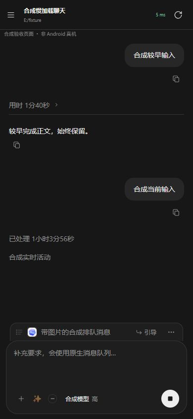

# 安卓会话加载与图片修复验收

日期：2026-10-18。源码修改、隔离验证和安装包构建已完成；未安装到手机，未替换或重启正式远程服务。

## 结论

总体状态为**部分确认**：已定位并修复可复现的源码缺陷，但未取得用户手机的 Android/WebView 版本、选图返回 Intent 和公网请求时间轴，不能把所有截图差异归为同一个原因，也不能将隔离测试耗时当作手机提速结果。

用户确认的图片症状是：系统选择图片后，编辑框没有图片，也没有提示。最直接匹配该症状的代码缺陷是普通选择器返回 `ClipData` 时，原实现交给只读取 `Intent.getData()` 的平台解析器，结果被当成取消。现在所有选择器结果统一解析 `ClipData` 和单个 URI，单张、多张及顺序均有对照验证。

| 问题 | 本次修改 | 证据 |
| --- | --- | --- |
| 系统选择完成后静默丢图 | 统一解析两种 Intent 返回形式，保留取消、旧请求隔离和一次回调；选择器无法启动时回退系统文档选择器 | [图片选择 RCA](android-images.md)、`file-chooser-clipdata-before.json`、`file-chooser-clipdata-after.json` |
| 正在读图时旧失败消息覆盖草稿 | 自动恢复旧失败输入前检查 `composerAttachmentsLoading()`；保留旧输入的恢复记录，不覆盖正在读取的图片 | `picker-resume-race-before.json`、`picker-resume-race-after.json` |
| 最近三轮历史串行读取 | 每页最多两轮并发，按原顺序归并，保留每轮分页、用户输入投影与失败语义；原生适配版本为 41 | [网页加载 RCA](web-loading-rca.md)、`source-functions-before.json`、`source-functions-after.json` |
| 实时活动先到，首屏历史尚未完成却失去加载状态 | 仅在首次历史未完成时显示顶部状态；完成或失败后清除，失败保留重试 | 浏览器对照及 `browser-loading-images.json` |
| 状态变化反复重建队列图片 | 同一设备、聊天及附件复用图片节点；换图时更新，失败图仍可重新加载 | `browser-loading-images.json`、`browser-image-retry.json` |

首次 WebSocket 连接后的补读保留。它用于补齐 HTTP 快照生成到事件订阅建立之间的更新，不能为减少请求而直接删掉。

## 图 1、图 2 的解释边界

- 图 1 已显示标题、队列和编辑框，说明页面创建已经完成；不能继续归因为“显示页面前仍在全量校验静态资源”。
- 图 1 的 `539 ms` 对应网页到 `/api/session` 的 HTTP 往返时长，不是历史正文或图片完整加载时间。
- 图 2 的正文较完整，但同时显示“连接中断 · 自动重连”。两张截图不能证明相同冷启动条件下的耗时比例。
- 本机服务与原有 release APK 的网页资源同版；原有 debug APK 只有两个静态文件不同，gzip 差异约 139 KB，连同清单约 140 KB。当前实现已有 gzip、摘要比较和未变文件复用，没有证据支持“每次必下载约 6 MB”。详见 [资源链路核对](android-transport.md)。

## 权限

最终 APK 声明 `INTERNET` 和 `ACCESS_NETWORK_STATE`，见 `apk-permissions.txt`。它们由安装阶段授予，不需要运行时弹框。系统照片/文档选择器按用户所选 URI 提供访问权，不需要应用先取得整个相册的读取权限。

本次没有新增照片或存储全库权限，也没有放开 `setAllowContentAccess(false)` 或本地文件访问。权限列表没有照片授权项，本身不能解释这次静默丢图。

官方依据：

```text
https://developer.android.com/develop/connectivity/network-ops/connecting
https://developer.android.com/training/data-storage/shared/photopicker
https://developer.android.com/training/data-storage/shared/documents-files
```

## 验证

| 验证范围 | 结果与限制 |
| --- | --- |
| 文件选择器与生命周期 | 最终 17/17 通过。仅使用前一阶段回调修复、仍采用平台结果解析器时为 14/17；三个 ClipData 场景失败。早先 12 项替身错误假定平台解析器支持 ClipData，局限已在图片报告中纠正 |
| 历史分页、并发、订阅间隙 | 13/13 通过；合成延迟下整页 183→128 ms，最大并发 1→2；不是手机实测速率 |
| 选图与失败输入恢复竞争 | 8/8 通过；真实切换聊天仍取消原聊天未完成的图片读取 |
| Chrome，390×844，模拟 Android 桥接 | 对照观测：原图节点 7→1、原图请求 3→1；显式换图才增加新节点/请求。图片失败后重连恢复、历史超时后恢复及聊天隔离均通过 |
| Rust 远程模块 | 首轮 19 项中 15 通过、4 失败；失败为测试等待超时及认证返回 401。既有用例的设备凭据有效期只有 60/120 秒，首轮与构建并行运行了 281 秒。停止并行构建后，同一测试二进制串行复测四项全部通过，16.44 秒；未改 Rust 源码或测试阈值 |
| JavaScript 与差异空白 | `node --check` 两个变更脚本、`git diff --check` 退出码均为 0 |
| Android Debug 构建、lint | `scripts/build-android.ps1` 成功，退出码 0；lint 为 0 errors、1 项已有资源目录警告 |
| Windows 配套构建 | 根目录 `build.ps1` 完整成功，退出码 0；未运行安装程序 |
| 产物一致性与签名 | APK 20 项网页资源的大小、摘要及源码对照全通过；APK v2 签名验证通过；Windows 分发副本一致，manager 中包含当前四份远程网页/原生脚本的完整字节 |

日志：`android-build-final.log`、`windows-build-final.log`、`rust-remote-access-tests.log`、`rust-remote-access-retest.log`、`apk-signature.txt`。完整摘要和资源比对见 `artifact-verification.json`。

## 交付

- Android Debug：`dist/android/CodexElves-0.5.0-android-debug.apk`
  - 应用 ID：`com.junxin367.codexelves.debug`
  - 字节数：`4,719,483`
  - SHA-256：`cdeab7c56c3f4ce971a09fc7c2704b8bd3feb641ccba8916a8aea1158720faca`
- Windows：`dist/windows/CodexElves-0.5.0-windows-x64-setup.exe`
  - 字节数：`42,441,518`
  - SHA-256：`3934ed274a6e219e179282325f68de84cbac829baf64d20335646a4205887360`

原生图片结果解析需要安装新版 APK；电脑侧历史读取并发需要同步更新 Windows 程序。网页资源仍按既有设计从电脑侧服务热更新；旧服务与新 APK 的资源版本可能不同，不能仅更新源码就宣称运行端已生效。本次不修改版本号，未安装、部署、提交或推送。

剩余设备验收是同一手机上打开系统选择器、单选/多选返回并显示预览、真实图片发送，以及相同网络下的冷启动和前后台恢复。此次没有连接 Android 设备或模拟器；截图是实际浏览器组件配合合成数据，不能替代真机截图。


