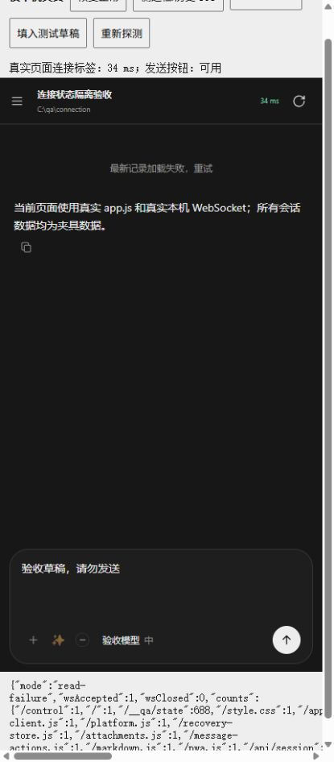

# 安卓频繁断开重连：排查与修复

日期：2026-10-18。用户确认持续前台、切后台/锁屏/选图后返回两种情况都有发生。

## RCA 结论

- **状态：部分确认。** 已确认并修复三类代码缺陷，完成本机对照和构建；没有取得手机上的 WebSocket 关闭码、生命周期时间轴和实际网页快照，不能声称所有现场断线均已消失。
- **现象：** 安卓频繁显示“连接中断 · 自动重连”。原实现既可能真的关闭连接，也可能只改变界面状态，必须分别验证。
- **直接原因与根因：**
  1. 普通历史、侧栏等请求的 5xx、超时和网络错误会直接写入全局离线状态；周期连接探测成功后，侧栏读取失败也会把健康连接改成离线。旧探针的结果还可能覆盖新连接。
  2. 页面隐藏时，`app.js` 和 fallback 传输层分别主动关闭连接。没有网络异常，仅隐藏两秒后返回也会新建 WebSocket。
  3. 服务端 WebSocket 循环只发送事件，没有读取客户端控制帧。实际依赖只有在读取时才处理 Ping/Close，原循环不会及时回 Pong 或完成关闭握手。
- **系统性原因范围：** 普通请求、连接探针和传输生命周期共用同一个可变连接状态；上下两层重复决定隐藏时关闭；服务端事件输出循环没有同时驱动 WebSocket 接收。已定位这些机制，未追溯到特定历史发布流程或人员。
- **关键因果链：** 普通读取错误→全局离线误标；页面隐藏→上下两层关闭→返回重新握手；未读取 Ping→不产生 Pong→要求 Pong 的对端可能主动关闭。最后一条是否在手机公网现场发生，仍缺证据。

## 实施结果

| 范围 | 修改 | 保留的正确行为 |
| --- | --- | --- |
| `assets/remote-access/app.js` | 普通请求错误只影响请求本身；连接探针按设备、stream、连接周期、原生版本与轮询版本校验结果；侧栏错误与探针错误分开 | 当前探针真的失败仍禁用发送；401 授权处理、动作结果未知及幂等保护保持；首次连接后的补读保留 |
| `assets/remote-access/app.js`、`events-client.js` | 隐藏只暂停轮询/watch/retry并取消旧探针，保留健康或握手中的 socket；恢复时检查当前连接 | 真正的 error、offline、超时仍重连；pagehide/beforeunload 真正离开时仍关闭；45/75 秒超时与既有 20 秒恢复宽限没有调大 |
| `crates/codex-elves-core/src/remote_access.rs` | 同时等待接收、广播与独立 15 秒心跳；驱动库的 Pong 和 Close 应答，关闭后释放订阅 | 发消息前后继续核对授权；授权撤销/服务停用仍发送终止事件并关闭；客户端 Text/Binary 不会成为动作入口 |

Java 容器、本轮 `events-worker.js` 与原生登录/图片选择代码没有修改；上一轮 ClipData、图片草稿保护、历史并发和图片节点复用均保留。

## 证据与验证

| 验证 | 结果 |
| --- | --- |
| app 实际源函数及生命周期回归 | **35/35**；覆盖普通请求失败、当前/旧探针成功失败、授权、渲染错误与前后台 |
| WS 客户端两条路径时序对照 | **19/19**；修改前有三个隐藏/恢复场景失败；健康前台十分钟心跳模拟未出现自发重连 |
| 实际 Rust 生产函数、本机真实 WebSocket | **5/5**；Ping payload 正确响应、Close/TCP 关闭释放订阅、授权撤销和服务停用关闭均通过 |
| 持续控制帧下的服务端心跳 | 发送 376 个 Ping 的场景中，业务 Text 正常，JSON 心跳在 **15.014 秒**到达；没有因控制帧持续到达而重置心跳 |
| Chrome 真实页面与真实本机 WS | 读取接口 503 时保留连接与发送能力；session 探针 503 时禁用发送；恢复后发送可用，草稿保留 |
| 浏览器连接数量 | 正常→读取故障→探针故障→恢复→读取故障，全程 **1 次连接、0 次关闭**；最终关闭测试页面后为 **1 次关闭、0 条活动连接**，没有发送实际消息 |
| 构建 | Android Debug、lint、根目录 Windows `build.ps1` 均退出 0 |
| 静态检查与产物 | JS 语法、Rust 格式、差异空白通过；APK v2 签名通过；20 项内置网页资源与源码一致；Windows 分发副本和嵌入网页脚本一致 |

证据索引：

- [app 35 项检查](app-connection.json)、[修改前对照](baseline-app-connection.json)。
- [WS 客户端 RCA](ws-transport-rca.md)、`ws-baseline.json`、`ws-fixed.json`。
- [服务端控制帧 RCA](server-ws-control-rca.md)、[实际生产函数验证](server-ws-function-evidence.json)、`server-ws-function-tests.log`。
- [浏览器状态对照](browser-connection-states.json)、`browser-page-close.json`。
- `android-build.log`、`windows-build.log`、`apk-signature.txt`、[产物摘要与源码匹配](artifact-verification.json)。

上述十分钟前台心跳和后台暂停/恢复时序属于受控测试，浏览器页面使用合成会话，不能当作 Android 真机或公网长时间稳定性测量。

## 公网地址与已排除解释

用户确认已经更换地址。按当前 `remote-access-zrok.json` 中公开的 `fixedName` 核对，实际入口为 `junxin367.shares.zrok.io`；未读取设备密钥、Cookie 或凭据文件。

当前入口公共资源接口的八次匿名请求均返回 HTTP 200，耗时 0.763–1.048 秒，详见 [公网 HTTP 记录](public-http-probe.json)。这只证明该时段匿名 HTTP 可达，不证明手机已授权 WebSocket 稳定。旧 `codex-elves-junxin367` 地址的 502 已排除，不用于本次归因。

原生审计没有发现 `onResume`、zrok Cookie 刷新或资源更新成功后主动 reload/清授权的路径，详见 [原生审计](android-native-rca.md)。其中另记录了 renderer 退出后恢复不完整的独立问题，但没有设备退出证据，不把它当成这次频繁重连的已确认原因，也未在本轮扩展修改。

## 交付与运行边界

- 安卓 Debug：`dist/android/CodexElves-0.5.0-android-debug.apk`
  - SHA-256：`35788cd769081dcdc0ed1337f08d311fb48b9eca8edead4ebefb3b1427b3dc51`
- 配套 Windows：`dist/windows/CodexElves-0.5.0-windows-x64-setup.exe`
  - SHA-256：`0e0e7b93fe5202c5fe8b0d38ebd06f003c8d3283984f933f79d6cc0e97f2795c`

**需要同步更新电脑端和安卓端。** 服务端控制帧修复位于 Windows 程序；网页资源也由电脑端提供热更新。探测时公网清单仍为 `9878532f…`，与本轮新包不同，仅更新 APK 不能保证电脑侧修复生效。

本次没有安装、重启正式服务、提交或推送，没有改版本号或系统权限。仍需在同一手机上核对持续前台、短暂切后台、锁屏恢复和网络切换后的真实关闭码及概率；不能把代码修复和本机通过等同于现场问题完全闭环。

临时测试入口、脚本、二进制及隔离状态文件均已删除，1467 测试服务已停止，浏览器视口已恢复。批量清理命令曾被自动审批以 `blocked by policy` 拒绝且未执行；随后依据逐项核验的明确文件路径完成清理，没有扩大删除范围。

## 浏览器验收截图

隔离环境中历史读取失败时，连接延迟仍可显示、发送按钮保持可用。不是 Android 真机截图。

