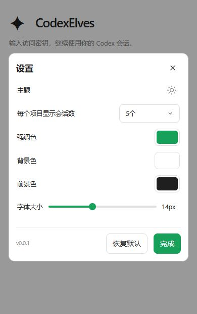

# Android 独立版本、更新与构建交付验证

2026-10-18：源码、隔离验证和本地完整构建已完成。Android 正式包为 `0.0.1`、`versionCode=2`；管理器保持 `0.5.0`。没有提交或推送本轮代码，没有发布 Android Release，也没有在实体手机安装。

## 需求完成情况

| 要求 | 实现与验证 |
| --- | --- |
| 按 Android 改动同步编译 | `AGENTS.md` 写入规则，根 `build.ps1` 在 Windows 成功后比较 Android 内容摘要；源码、内置网页、版本和构建脚本有变化或产物失效时构建正式 APK。本轮根入口已实际触发 Android 构建 |
| Android 独立版本 | `version.properties` 为 `0.0.1/code2`，Gradle、输出文件、更新清单及 APK 实际元信息一致；不修改管理器版本 |
| 设置左下显示版本 | 真实 Chrome 使用实际网页源码及隔离原生消息桥，验证 `v0.0.1` 与右侧按钮同行、字号较小、使用弱化颜色；普通网页和无版本回复的旧外壳不显示猜测版本 |
| GitHub 应用更新 | 自动及手动检查独立 Android Release，下载后检查大小、摘要、包名、版本、系统要求和签名，再交系统安装；保持来源授权与最终安装确认 |
| GitHub 编译配置 | Android 相关 main 推送生成正式产物，PR 进行不持有发布密钥的 Debug 检查，`android-v*` 标签发布独立 APK 和清单；草稿上传校验后公开，不改变桌面 Latest |

## 验证结果

- `build/script-fixtures.json`：43 项构建/指纹/清单夹具及 7 项发布定向验证通过。
- `build/workflows.json`、`build/pr-filter.json`：17 项工作流结构、16 项 PR 路径场景、12 个 PowerShell 块解析通过。
- `native/verification.json`：276 项生产策略断言、26 项生产传输断言通过；真实公开 GitHub API 返回 HTTP 200，当时符合独立 Android 发布合同的候选为 0。真实 SDK 35、AndroidX、AAPT2 与 Java 编译通过。
- `review.md`：独立集成审查通过；旧标签重跑先被新版本拦截的问题已修复并定向复核。
- `web/browser-layout.json`：6 组真实浏览器检查，覆盖 320px 大字号、390px 深浅色、768px 小字号、普通网页及旧外壳。有效版本场景同行且无重叠；隐藏版本场景继续保持按钮靠右。`browser-bridge-events.json` 记录一次手动点击只发送 `check-app-update`，普通网页不请求 Android 信息。
- 根 `build.ps1` 完整退出 0，包含 Windows、Android Release、R8、lint、签名和更新清单生成。Android lint 为 0 错误、1 条已有 `ObsoleteSdkInt` 提示。
- 构建后再次执行 `sync-android-build.ps1` 实际跳过，APK 时间戳和 SHA-256 不变，见 `unchanged-build.json`。
- `publish-android-release.ps1 -Tag android-v0.0.1 -ValidateOnly` 通过；未执行发布。
- 最终差异空白检查通过。

## 产物

| 产物 | 大小 | SHA-256 |
| --- | ---: | --- |
| `dist/android/CodexElves-0.0.1-android.apk` | 2,226,239 字节 | `c7dc0327a24b6e19184020eaaf8401923b952f3c484fbc251622f35011a7d501` |
| `dist/windows/CodexElves-0.5.0-windows-x64-setup.exe` | 42,450,390 字节 | `162b2932ea1d2661b47ad2de4f6ec6f050f8c5b8f8ee76998bc99dbca1207978` |

正式签名证书保持 `7b15895625b40e03792fc250a1fc489df11fe03a25f7e8f1e177d2442fe9dc2d`；APK 包名为 `com.junxin367.codexelves`，未开启调试。20 项内置网页文件的大小、摘要和实际字节与源码一致，资源版本独立重算一致：`d2aeab9568065682558d568f94278a66c757f73c332e22def4f2912322744fbc`。

Windows 三份编译输出与分发副本逐一匹配，manager 含当前 `app.js`、`platform.js`、`pwa.js`、`style.css`。详情见 `artifact-verification.json`。

## 云端配置与验收边界

已将既有正式签名配置通过 GitHub CLI 的本地加密 Secret 流程配置到 `junxin367/CodexElves`，四项 Secret 名称与成功退出码记录于 `github-signing.json`；未将密码、私钥或其 Base64 内容写入仓库或本报告。代码和工作流尚未推送，云端工作流尚未运行，GitHub 上尚无本轮 `android-v0.0.1` Release。

没有 Android 真机或模拟器验收；来源授权、系统安装确认和取消、进程被系统回收后的行为仍需设备验证。网页截图使用隔离消息桥，不能作为原生系统安装的证据。运行中的电脑端服务未替换，新网页资源需更新电脑端程序后生效。

本轮临时测试源码、编译副本、夹具、预览服务和标签已清理；浏览器视口已恢复。批量清理曾被自动审批拒绝，主代理核实目录无链接后，使用明确文件列表和空目录删除完成收尾。用户原有 `.playwright-cli/`、Android 工具链和此前交付的按钮预览保持。

