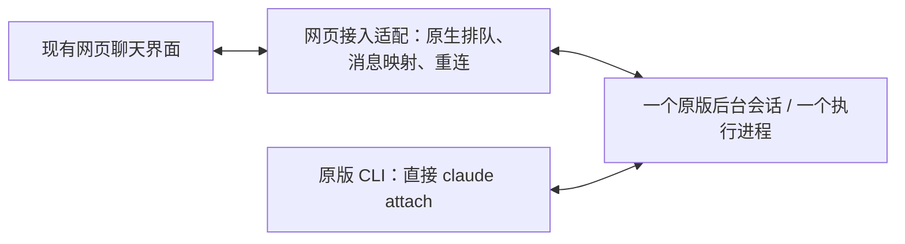

# Claude 原版 CLI 与网页双向实时会话：能力验证与方案

核对日期：2026-11-11。本文件保留前期能力验证，并记录用户确认方案后的开发与验收进展。

## 结论

测试 WSL 中的原版 Claude Code 2.1.322 已具备真正共享执行进程的终端底座：`claude --bg` 创建后台会话，多个 `claude attach <id>` 可以同时进入这个会话，实时共享输入、输出、工具界面及权限等待。

前期项目使用的 `--print --input-format stream-json --output-format stream-json` 无法加入这个运行中的后台会话。后续开发已为新会话接入原生后台队列，旧 print 会话仍保留原有身份与历史，不自动迁移。

用户已明确网页继续使用现有聊天展示效果，消息、回复与执行状态需要映射回现有界面。发送控制只约束网页，Claude 原程序继续正常使用，不要求其经过自研包装命令或取得网页控制权。

共享原版终端只作为底层能力，不作为最终网页呈现方案。当前实现通过本机 2.1.322 的原生后台协议投递整条消息，按原生历史投影到现有聊天组件；执行中正文预览由原版输出形成，原生完整消息到达后用 Markdown 原文替换预览。后台协议尚未公开承诺稳定，需要随 CLI 版本回归。

用户进一步明确：原生队列可用时，不增加网页忙碌禁发。真实网页已验证执行期间连续提交两条消息，均被同一原生队列受理。原版可能将连续待处理消息合并到一次模型回复中；网页保留这一行为，不强制每条消息单独回复。

## 开发后的网页验收

使用独立服务 `47136`，网页会话 `claude-80d288b2-f579-4d41-a6fa-b8fe0169ae88`，原生 UUID `2c3c4d2e-9f43-4e2f-b3ad-dd703467e217`，原版连接命令为 `claude attach 2c3c4d2e`。

| 项目 | 实际结果 |
| --- | --- |
| 执行中连续发送 | 两条补充消息分别受理，待处理数依次为 1、2，随后清空；原生 UUID 未变，规范历史只有三条用户消息 |
| CLI → 网页 | CLI 发出中文消息，网页未刷新即显示该消息及回复，并能引用之前的两个测试标签 |
| 网页 → 已连接的 CLI | 从真实网页输入框发送，持续连接的原版 CLI 显示该消息与生成活动，最后回复“网页与 CLI 双向同步成功。” |
| 图片交给原版模型 | 网页上传纯蓝测试图，原版将图片作为原生文件附件读取，回复“蓝色” |
| 图片展示修复 | 初次只显示 `0.png` 临时路径链接；修复后旧图片自动补回，64×64 缩略图与点击放大的原图均实际加载成功。随后通过网页“添加图片”再次上传并发送，CLI 同步收到且回复“蓝色” |
| 网页服务重连 | 仅重启独立验收服务；离线期间从 CLI 发送的消息及回复恢复后自动补齐。主验收会话 UUID 和 PID 12437 均未变，用户原生任务 `1a330774` 的 UUID 和 PID 3881 也未变 |
| 一次工具批准 | 独立 Write 权限样例中，批准前文件不存在，一次批准后生成预期内容；规范历史中 Write 的 tool_use、tool_result 各一条，保留原版权限规则 |
| 自动测试 | 前端 231 项通过；Claude 后端 9 项通过；管理端资源检查及 TypeScript 检查通过；工作区 `cargo check` 通过 |

队列受理及规范历史证据保存于 `temp/claude-web-shared-check.json`，图片与重连后的历史核对为 `temp/claude-web-final-check.json`，原生进程核对为 `temp/claude-native-restart-check.json`，工具批准证据为 `temp/claude-permission-check.json` 和 `temp/claude-permission-canonical-check.json`。

最终历史共有 8 条用户消息，客户端消息 ID 也为 8 个；两条图片消息均保留，队列为零。页面刷新后两张缩略图及点击放大的原图再次通过加载核对，名称显示为“图片附件”。截图保存于 `temp/claude-image-chat-fixed.jpg` 和 `temp/claude-image-preview-fixed.jpg`。临时浏览器网络覆盖已恢复。

最终独立验收服务 PID 为 25320，端口仍为 47136。原管理器、launcher/代理及原远程服务的 PID 和启动时间未变，6 份原配置 SHA-256 均未变，详见 `temp/claude-final-isolation-check.json`。未操作 `claude-us`，未提交、暂存或发版。

临时检查副本、权限测试目录及 Python 缓存的批量清理被自动审批策略拦截，该次命令没有执行；这些临时文件保留在原处。

扩大到全部 remote-access 单元测试时，浏览器撤销测试曾失败且多项浏览器测试长时间未结束，因此该轮已停止，不把它记为全量通过。单独复跑 `revocation_read_only_and_service_stop_close_existing_tcp` 已通过（18.22 秒）。

## 实测环境与身份

- Distribution：`codex-elves-claude-test`，用户：`elves-test`。
- CLI：`/home/elves-test/.local/bin/claude`，版本：`2.1.322`。
- 认证：沿用既有 API Key 与自定义 Anthropic Base URL，模型为 `claude-haiku-5-5`。
- 测试工作目录：`/home/elves-test/duplex-probe-20261111-f9c4db`，带独立标记文件。
- 后台短 ID：`b88b5212`。
- 原生会话 UUID：`b88b5212-74e0-4eb7-adb9-b8eb6afa76a1`。
- 所有实时测试期间唯一的该会话执行进程：PID `1194`。两个 attach 客户端只是连接端。

启动方式：

```sh
claude --bg --model claude-haiku-5-5 --name elves-duplex-f9c4db \
  "Remember the token DUPLEX-F9C4DB. Reply only READY-F9C4DB. Do not call tools."
claude attach b88b5212
# 第二个终端也执行同一条 attach 命令
```

只对上述自建目录接受了原生信任提示。没有使用 bare、替代系统提示或跳过权限参数。原生默认显示 auto mode；测试目录另设 Write、Edit、Bash 的 ask 规则。因此本轮审批结果仅证明这些明确规则有效，不能推广为所有工具都会逐项询问。

## 前期原版终端验证结果（网页开发前）

| 要求 | 本轮观察 | 边界 |
| --- | --- | --- |
| 双向消息与生成过程 | A 发消息，持续在线的 B 实时显示用户消息、生成活动、文本更新和完成状态；B 发消息，A 同样更新 | 两个原版终端通过，网页尚未接入 |
| 同一上下文 | B 能引用初始 token 与 A 的回复；整个过程 UUID、执行 PID 未变 | 未使用 resume 或 fork 制造第二个执行器 |
| 问题与权限等待 | 两端均显示同一个 AskUserQuestion，随后显示同一个 Write 权限面板；审批前文件不存在 | AskUserQuestion 与工具权限是两种不同交互 |
| 一次批准和工具执行 | 在 B 选择一次 Write 的 Yes，A 的等待面板同步消失，两端显示同一工具结果 | 原生规范消息记录中 AskUserQuestion、Write 各有一个 tool_use 和一个对应 tool_result；不代表已证明所有崩溃场景的 exactly-once |
| 断开后补齐 | A 用 Ctrl+Z 断开客户端，B 继续发送 `RECONNECT-F9C4DB`；A 重新 attach 后看到该消息和回复 | 仅验证一次客户端 detach/reattach；未证明任意网络、服务重启或长历史窗口下无损恢复 |
| 停止一致 | 新请求显示生成活动期间，A 按 Ctrl+C；B 同步停止活动并恢复相同草稿，唯一执行进程保留、状态回到 idle | 此次在正文输出前取消；长工具子进程、审批期间停止和输出中取消的竞态未覆盖 |
| 同时输入 | B 尚未发送的草稿已实时显示到 A | 两端共享编辑器，直接并发打字有冲突；未通过并发排队/拒绝验收 |
| 工具与扩展 | 原版 Write、AskUserQuestion 及权限规则实际生效 | MCP、Skills、Hooks 的具体配置组合尚未逐项回归 |

另一次长输出尝试在 Ctrl+C 前已自然结束，不能算作停止成功的证据。本报告只把后续确实处于生成活动中的取消列入结果。

取消后读取 `claude agents --json --all`，曾同时出现 `status: idle` 和 `state: working`。终端画面已停止，但外部结构化状态不能仅凭单个字段判定终态；这一点仍需专门的状态收敛验证。

原生 JSONL 含请求快照等辅助记录。上述计数只统计带 UUID 的规范 user/assistant 消息，不能把请求快照当成再次发送或再次执行。

## 原 print 协议的兼容边界

实测以下组合直接退出，exit code 为 1：

```sh
claude --bg --print --model claude-haiku-5-5 "只回复 OK。"
```

CLI 明确报告 `--bg` 与 `--print` 冲突，因为 print 不创建可 attach 的交互会话。

保持后台执行进程与两个 attach 客户端在线时，另测：

```sh
claude --print \
  --resume b88b5212-74e0-4eb7-adb9-b8eb6afa76a1 \
  --model claude-haiku-5-5 --output-format json --max-turns 1 \
  "Reply only SDK-RESUME-F9C4DB. Do not call tools."
```

CLI 拒绝，并要求使用 `claude attach b88b5212`，或先停止再 resume；加 fork 只能创建副本。先停再恢复属于接力，fork 属于另一个会话，均不满足同时实时共享。

后端位置为 `crates/codex-elves-core/src/remote_access/claude.rs`。新会话走共享连接端；模型能力探测及旧记录走 `spawn_stdio`。没有把追加 resume 当作实时共享实现。

## 推荐接入方案与必要约束

### 现有网页界面与原版 CLI 共享会话

以一个原生后台会话作为唯一执行器。网页继续使用现有消息列表、Markdown、工具卡片及执行状态展示，由接入适配层把原生会话活动映射到这些组件。原版 CLI 通过自身的 `claude attach <id>` 直接连接同一会话，不增加限制它输入的包装入口。

网页需要显示从 CLI 发起的消息和后续执行过程；网页提交的消息也必须进入上述同一原生会话，在 CLI 中可见。原版 Claude 负责模型请求、工具、权限以及扩展，不通过另开 print 进程或重放提示模拟共享。



图中的网页适配已经开发；前期双终端结论与开发后的网页验收分别记录，不混作同一项证据。

### 原生队列与最小网页保护

- 网页执行中可继续发送，整条交给原版队列，不另建网页执行队列。
- 仅当前提交尚未返回受理结果时防重复点击；受理后立即恢复发送。原有设备授权、离线状态与请求回执机制继续生效。
- 不新增忙碌禁发、控制权租约、跨客户端锁或额外人工解锁流程。Claude 原程序保留自己的输入、发送与队列行为。
- 普通消息不通过模拟键盘逐字输入；原生整条入队入口不拼接或清空 CLI 草稿。
- 原版冷启动明确报告“尚未接受”时，连接端短暂等待其就绪；没有确认结果的提交不自动重发。
- 原生审批在 CLI 完成后，网页同步移除对应等待。网页已经适配的批准、拒绝与单问题回答仍使用同一个原生请求；多问题面板需在 CLI 回答。

同时提交的实际执行顺序由原版队列决定，不承诺两个独立客户端之间的严格全局互斥。网页没有限制 CLI，也没有为假设中的小概率交错增加限制。

原版 Git 仓库中的后台会话默认先进入 worktree 再编辑。实际测试发现这一默认值会拦住所选项目目录中的 Write；网页新建会话通过会话级 `--settings '{"worktree":{"bgIsolation":"none"}}'` 保留原目录，不改项目或全局设置，也不改变工具审批规则。

网页刷新或断网只断开网页连接，不自动停止后台会话。恢复时按原生消息身份补齐历史，再衔接执行状态更新；显示补齐不重新提交消息或批准操作。本轮已完成真实网页连接中断及服务重启后的补齐验收，不代表任意网络、崩溃时间点和长历史组合均已覆盖。

### 不重不乱与一次性边界

- 连接服务沿用网页请求 ID 和受理回执，将规范原生消息 UUID 关联到网页客户端消息 ID；同一请求重试返回既有结果。这些记录不限制 CLI 的原生提交。
- 网页待批准操作必须在原生请求已处理或失效后同步失效，拒绝网页旧状态发起的操作，不重发已确认的批准。
- 服务崩溃可能发生在“原生队列已受理”与“网页回执已保存”之间。没有原版支持的事务确认，无法同时无条件保证必达与 exactly-once；沿用已有回执核对机制，不新增额外保护层。
- 公开的终端接口没有提供与现有 stream-json 等价的稳定结构化审批事务。因此上述措施仍需故障测试，不能凭 PTY 方案承诺全部严格保证已满足。

### 现有聊天界面的适配边界

本轮未找到可让自定义网页以 stream-json 客户端加入该运行中交互会话的官方稳定接口。`claude agents --json --all` 可读状态；`claude logs` 输出近期终端画面，均不能替代完整的结构化双向协议。官方也明确说明 jobs 目录内部文件不是稳定接口。

现有聊天展示效果是用户要求，适配层需要围绕这一要求验证。不能靠 tail JSONL、解析屏幕或修改 jobs 状态文件，就宣称完整流式、审批、并发及崩溃恢复均已解决。采用未公开协议还需要版本固定、兼容探测及升级回归。

## 用户需要的启动方式

当前网页接入从网页新建 Claude 会话，然后点击页头「CLI」复制该会话的 WSL 连接命令，在终端执行。原生命令形式为：

```sh
claude attach <网页会话对应的短ID>
```

已有普通交互会话可在其内部使用 `/background`（别名 `/bg`），官方描述为移到后台。但本轮没有迁移用户已有会话；实施时必须核对迁移前后的原生 UUID、权限与扩展配置，遇到复制或 fork 必须拒绝当作同一会话。

不能无提示地用另一条 `--resume` 启动命令代替接入。旧网页 print 会话不能在持续执行期间直接转换成上述交互底座，原身份与历史继续保留；从 CLI 独立创建的未登记会话不会自动出现在当前网页列表中。

## 官方 Remote Control

官方 Remote Control 提供本地 CLI 与 claude.ai/code、Claude App 的实时共享，但官方要求 claude.ai 订阅登录，不支持 API Key，且禁用指向非 api.anthropic.com 的 ANTHROPIC_BASE_URL。

当前环境运行 `claude remote-control` 实际退出，提示必须用 claude.ai 订阅登录。本轮未修改认证或网关，也未尝试以官方云界面替代当前自定义网页。

## 前期探测收尾与证据（网页开发前）

- 自建 attach 客户端均已断开，后台 job 已原生 stop，PID 1194 已退出，自建测试目录已校验标记后删除。原生测试历史保留用于核查。
- 测试后原生 supervisor 显示 not running、bg workers 为 0。
- 用户原有交互会话 PID 565、原生 UUID `48c37919-285f-4a39-8992-cd089f3e15f8` 保持运行。
- 只操作了 `codex-elves-claude-test`，没有调用 `claude-us`。
- 原 manager、launcher、本地代理与原远程服务的 PID 和启动时间均保持；6 个原配置文件 SHA-256 全部一致。
- 独立验收服务 PID 8248、端口 47136 保持；原代理 45221 和远程服务 45222 的进程归属保持。
- 本地证据：`temp/claude-duplex-probe-20261111.json`，只含测试消息、工具 ID、计数及隔离检查，不含 API Key。

官方核对来源（2026-11-11）：

- Manage multiple agents with agent view：`https://code.claude.com/docs/en/agent-view`，涉及 bg/attach、配置继承、状态接口、print 冲突及预览状态。
- Continue local sessions from any device with Remote Control：`https://code.claude.com/docs/en/remote-control`，涉及多端同步与认证/端点限制。
- CLI reference：`https://code.claude.com/docs/en/cli-reference`，涉及 print、resume 与交互命令。

Agent view 仍标为 research preview。本报告验证的是本机当前 2.1.322 的行为，未把它当成永久不变的公共传输协议。
