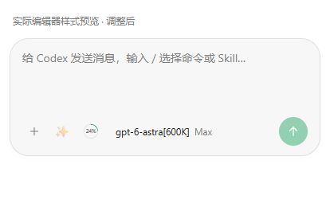

# 编辑区底部按钮间距验证

2026-10-18：仅调整 `assets/remote-access/style.css` 的左侧功能区间距，桌面从 10px、手机从 5px 统一为 8px；移除会覆盖统一值的移动端规则。按钮尺寸、内边距、输入高度、外层工具栏和发送按钮声明均未修改。目标模式在 390px 及以下保留模型换行与 2px 行间距。

真实 Chrome 加载从当前 `app.js` 提取的编辑器结构及图标，分别使用修改前 HEAD 和修改后 CSS。预览使用模拟用量、模型和主题，没有连接真实会话，也不是 Android 真机截图。

- 共 11 组修改前后对比：320、360、390、414、768、1280px，另包含 18px 字号、目标模式、深色停止状态。
- 每组左侧列间距均为 8px；发送按钮的坐标、宽高、内边距、字号、颜色和圆角与修改前一致，外层工具栏间距保持 12px。
- 无页面横向溢出或按钮重叠；390px 及以下目标模式的模型换行保持。
- 414px 手机样例：发送按钮前后均为 x=350、y=147、36×36px；模型选择器起点从 x=129 调整为 x=138。
- `git diff --check` 通过。

逐项数据见 `browser-measurements.json`；实际截图见 `composer-mobile.jpg`。临时预览脚本和本机服务已清理，浏览器触屏及视口模拟已恢复，测试标签已关闭。本轮没有重新打包、提交或更新运行服务。

