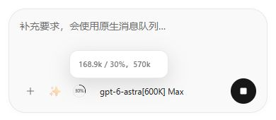

# 上下文用量浮层自适应宽度

2026-10-18：仅调整 `app.js` 的 `fitContextUsageTip()`，把固定 300px 改为 `max-content`。通常最小 140px、最大 300px；视口不足时同步降低限制，保留左右各 8px。字号、灰色用量内容、悬停与点击交互、高度和上下避让保持原逻辑。

真实 Chrome 运行生产浮层函数、编辑器结构及完整 CSS，用量数据为本机模拟。未连接真实会话，截图不是 Android 真机截图。

- 390px 视口、14px 设置字号：`168.9k / 30%，570k` 从 300px 收窄至 140px。
- 短内容宽度为 140px，长数值内容扩展至约 251.34px；切回常规内容后重新收窄至 140px。
- 320px 视口、20px 设置字号：长内容宽度止于 300px，自动换行，无水平溢出。
- 280px 视口：最大宽度降低到 264px，左右各 8px；只改变视口大小也会正确重新定位。
- 鼠标进入显示、离开关闭，以及点击固定、再次点击关闭均通过。浮层保留一个用量内容节点。
- 9 组稳定布局读数通过宽度和视口边界检查。首次缩放后过早采样记录了尚未重排的旧宽度；等待实际样式更新后，纯缩放往返检查通过，原始读数保留于 JSON。
- `node --check assets/remote-access/app.js` 与定向 `git diff --check` 通过。

数据见 `browser-results.json`，效果见 `mobile-context.jpg`。临时服务、脚本、浏览器标签及视口模拟已清理。本轮未构建安装包、提交或部署。

验证时 `app.js` SHA-256：`2bdddA3eaf50af87ebcf44ac15d41b4e73556e1131381c59ae42202a5b385b99`。

