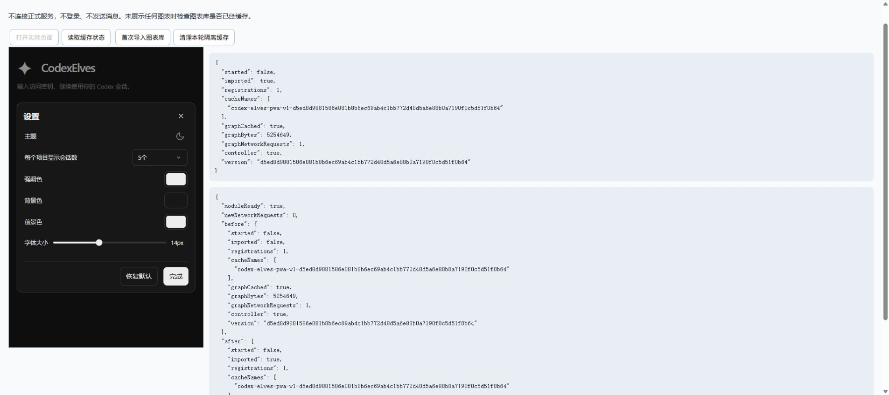

# 静态资源空闲预下载验证（2026-10-18）

本轮删除设置中基础缓存就绪的状态文案，`ready` 状态行隐藏并清空，检查、安装、待启用、失败、恢复提示及重试入口保留。旧 worker 发送的 `ready` 文案同样不会显示。

Mermaid 从仅按需下载改为加入原有空闲队列。全部 8 个可选静态文件按大小升序准备，5,254,649 字节的 Mermaid 排在末尾；它仍不属于基础页面安装必需资源，也没有提前导入执行或新增 `modulepreload`。

## 方法与结果

临时 Node 执行器直接执行实际 `assets/remote-access/sw.js` 源码，使用内存 Cache Storage、受控网络和时钟。夹具来自当前仓库 8 个实际可选文件及首页的完整字节，按真实摘要格式生成版本清单；未复制下载或调度实现。结果保存在 `sw-results.json`，**9 组通过，0 组失败**：

| 场景 | 结果 |
| --- | --- |
| 未触发任何图表时，空闲准备完整可选清单 | 8 项全部下载，按大小升序，Mermaid 最后，全部低网络优先级，后台并发峰值 1 |
| 预下载完成后的首次 Mermaid 请求及 `?retry=1` | 内容与实际文件一致，额外网络请求 0 |
| 忙、应用未就绪、页面不可见、消息版本不符 | 均不启动预下载 |
| 空闲队列授权后转为前台忙，再恢复空闲 | 忙期间请求数 0，恢复后完成 8 项 |
| Mermaid 预下载途中被当前页面按需接管 | 原任务提升为前台，同一路径只有一次网络请求，未中止该任务 |
| 可选任务被主动操作中断两次 | 退避五分钟并继续后续资源，当前页面需求可绕过退避 |
| Mermaid 摘要不符 | `force-cache`、`no-store` 各试一次，不写入缓存或触发恢复页；退避后可成功续试 |
| 已有缓存正文损坏、当前 worker 就绪版本不符 | 损坏正文重新校验修复；错误版本不启动后台准备 |
| 三项前台需求同时出现 | 下载并发峰值保持 2 |

相同执行器对修改前的 `HEAD` Service Worker 验证，得到 2 组通过、7 组预期失败，记录为 `baseline-sw-results.json`。这些失败共同反映 Mermaid 被排除在空闲准备之外，包含空闲后仍未缓存、首次需求仍需联网等断言，不代表七个独立产品缺陷。验证器曾因未等待异步摘要完成而提前断言；改为等待实际请求状态后，最终结果如上。

`node --check` 检查 `sw.js`、`pwa.js`、`app.js` 均通过；目标源码与使用说明的 `git diff --check` 通过。设置状态行的处理同时利用已有全局 `[hidden]{display:none!important}`，不会保留原行的布局高度。

## 原提示的含义

原 `ready` 状态仅表示基础页面缓存已完整保存，不代表可选资源全部准备完毕，也不代表所有聊天内容均已离线保存。此前 Mermaid 被 `demandOnlyResourcePaths` 明确排除，首次出现可视图表才下载；这一例外与本次要求不一致，现已删除。

当前清单内的静态文件都可以在页面可用、网络空闲时预下载；“下载文件”和“导入、执行、绘制图表”分开，预下载不会提前执行整个图表库。Android APK 原本就内置全部 20 项静态文件，原生更新也遍历完整清单，本轮没有修改 Java。

## 真实浏览器验证

主代理在独立的 `127.0.0.1:1491` 站点运行实际页面、实际 Service Worker 和全部真实静态资源。接口仅返回隔离登录状态，不访问正式服务，不登录、不发送消息。

- 初始状态：注册数 0、缓存为空、Mermaid 网络请求 0。
- 没有打开任何图表时：Mermaid 的 5,254,649 字节已经缓存，网络请求 1，尚未导入模块。
- 在正常新开、已由 worker 控制的页面首次实际 `import()`：模块成功导入，额外网络请求 **0**，总请求仍为 1。
- 实际设置弹窗：`appearance-cache-state` 隐藏且文本为空，目标提示不存在，不保留布局空行。
- 完成后注销本轮 worker、删除本轮缓存并关闭测试标签；注册数 0、缓存为空。

证据：`browser-idle-cache.json`、`browser-cleanup.json`、`settings-and-cache-browser.jpg`。首次安装不会强制接管旧页面，验证没有改变这一版本隔离机制；第一次导入的零网络结果来自已正常启用该缓存的受控页面。

## 构建与交付

Android Debug 构建及 lint、根目录 `build.ps1` 均退出 0。APK v2 签名验证通过；20 项内置资源与当前源码完全一致；Windows 分发副本一致，manager 包含当前 `app.js`、`pwa.js`、`sw.js`。APK 的资源版本与本次浏览器实际验证的版本一致：

`d5ed8d9881586e081b8b6ec69ab4c1bb772d48d5a6e88b0a7190f0c5d51f0b64`

- `dist/android/CodexElves-0.5.0-android-debug.apk`
  - SHA-256：`603cc795e6de75f80cc9ae80121da2e5d7f91deeb6a6bc316f5b858600b94d17`
- `dist/windows/CodexElves-0.5.0-windows-x64-setup.exe`
  - SHA-256：`1deb1641c4601b66de7f09a5080818927115503c1c2450c87d2fd8fd2875e613`

详情见 `artifact-verification.json`、`android-build.log`、`windows-build.log` 和 `apk-signature.txt`。

## 验证范围

静态队列尚未完成时，首次访问某项资源仍可能联网；会话正文、审批和图片附件是动态数据，本轮不会全量下载所有聊天，也不承诺它们全部离线可用。没有实体手机验收，没有安装、重启正式服务、提交或推送。正式网页需要更新电脑端程序并正常启用新版网页缓存后生效。

本轮临时验证脚本与目录已清理，1491 隔离服务已停止；测试站点的 worker 和缓存已清理，浏览器测试标签已关闭。验证 JSON、日志和实际截图作为交付证据保留。

