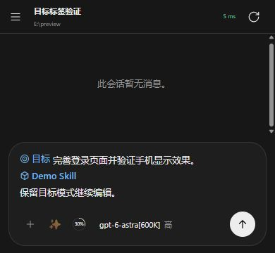

# 目标行内标签验收

2026-10-18：目标仅在输入编辑区中显示为单个前缀标签，与 Skill 共用颜色、字号、图标尺寸和基线。正文可继续输入、换行和编辑；移除标签取消当前草稿的目标模式，保留其余内容。底栏原目标模式按钮及其专用换行布局已删除。

已发送消息和历史不增加目标标签；服务器已有目标栏及目标编辑功能保持原状。显示标签不计入正文长度、Skill 位置或提交内容，现有目标草稿 nonce、持久化和回执合同不变。

## 验证结果

- 33 项生产函数回归在 jsdom 通过，详见 `dom-regression.json` 和 `dom-regression.md`。这不是 33 项浏览器验收。
- 完整生产网页在 Chrome 连接本机 HTTP/WS 模拟服务。通过真实加号和斜杠菜单、输入、换行、Delete/Backspace、全选删除与替换、双会话切换、刷新恢复进行了验证。
- 使用旧版代码生成带目标模式、正文和 Skill 的实际 IndexedDB 草稿；新版恢复为一个目标标签和一个 Skill，没有改写存储结构。
- 首次验收发现加号入口光标落在标签前，已修复并复测：空稿添加后可立即退格删除；已有正文中间添加后输入，光标位置保持。
- Chrome 输入法协议模拟组合、提交后标签保持；这不等同于实际安卓系统输入法或真机验收。
- 13px 默认字号下，目标与 Skill 都使用 14px 图标及同色文字；手机视口无横向溢出。
- 模拟服务只收到一次 `setGoal`：正文等于原文字加既有 Skill 引用，保留 `goalMode:true`，没有添加目标显示标签。成功回执后编辑框清空，消息区域的 `.inline-goal` 数量为 0。
- 独立只读审查通过；JS 语法和定向差异检查通过。最终审查及浏览器验收的 `app.js` SHA-256 相同：`34e9a6025721054983af1e7a8030a88c42c995af4802e8f0438276a9fde5920f`。

浏览器记录见 `browser-results.json`，实际模拟请求见 `submitted-request.json`。全部 API 写操作只作用于本机模拟数据，没有创建真实目标、发送真实消息或运行模型。临时测试脚本、依赖、预览服务、浏览器标签和预览站点数据已清理。本轮未构建安装包、提交或部署。

