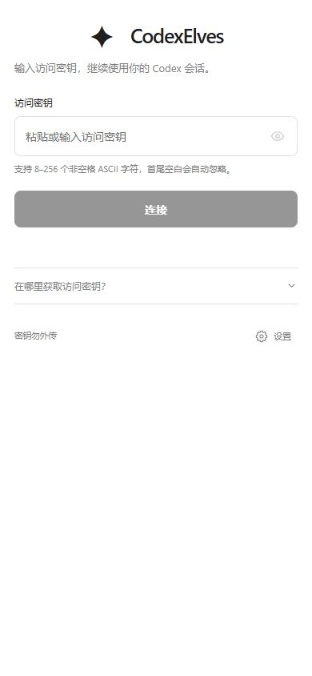

# 登录页图标与标题居中

2026-10-18：网页与安卓原生登录页已同步调整，图标和 `CodexElves` 标题按内容宽度作为一组水平居中。

- 网页登录页和连接恢复页使用同一个 `.pair-brand` 布局。保留图标尺寸、标题字号及头部间距；说明文字独占下一行、左对齐，窄屏可以自然换行。
- 安卓将固定文字框中的星形字符替换为 40dp 四角星矢量图，避免图标随系统字体缩放而被固定高度裁切。标题保留 28sp，不限制行数、不省略；窄屏大字号时可以完整换行。
- 安卓标题行以下 XML、登录逻辑、420dp 表单最大宽度和整体垂直居中保持原状。

## 验证

真实 Chrome 加载完整生产网页，只有登录状态接口使用本机 401/503 替身，没有输入访问密钥或执行登录。

- 390×844、14px 字号：图标与标题组合的中心偏差由约 -92.88px 改为 -0.008px。
- 320×640 和 1280×800、20px 字号：标题文字与图标完整位于视口中，无祖先裁切、无页面横向溢出，中心偏差均小于 0.01px。
- 连接恢复页在桌面大字号下同样通过居中与完整显示检查。
- JS 语法与目标差异检查通过；安卓 AAPT2 资源编译、链接和编译后 XML 检查通过。原生证据与范围检查见 `native.json`。

网页测量见 `web.json`；`web-mobile.jpg` 为实际网页登录页截图，**不是安卓真机截图**。没有设备或模拟器，安卓 320dp、200% 系统字号和 TalkBack 尚未实际运行验收。

本轮未重新构建安装包、安装、提交或部署。临时验证服务、脚本、浏览器标签和本机预览数据均已清理。

