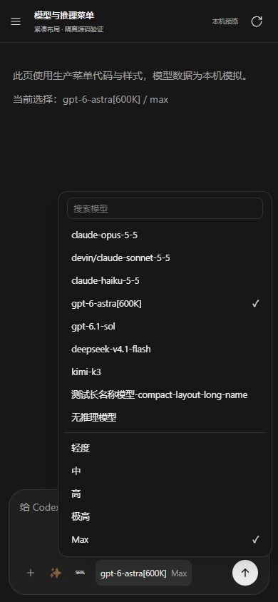

# 模型与推理菜单紧凑布局验证

2026-10-18：只修改远程会话模型菜单的布局和选择后处理，保留工作区已有修改。

- 模型、推理选项最小高度统一为 32px，上下 padding 从 8px 改为 5px，字号和行高比例不变。网格按内容排布，避免剩余空间拉大选项间距。
- 模型与推理选项共用选择后处理：更新选择、关闭菜单、焦点返回输入框。点击当前模型也关闭，但不重置已选推理等级。
- 既有新模型默认推理回退、不可选模型禁用、搜索、滚动和视口定位保留。

真实 Chrome 加载生产源码中提取的菜单渲染、选择、关闭、键盘和定位函数，以及完整 CSS。模型目录及周边接口为本机替身，没有连接真实会话或发送请求；截图不是 Android 真机截图。

验证结果：

- 390×844、14px 设置字号：修改前所有选项高 44px，修改后 32px，实际文字均为 12.6px。9 个模型和 5 个推理选项的样例菜单从 560px 缩为 513px。
- 320×640、20px 设置字号：选项随内容增高至约 35.19px，文字为 18px；菜单未超出视口，没有页面横向溢出。
- 1280×800、14px 设置字号：选项高 32px，菜单边界正常。
- 7 项交互通过：点击当前模型保留 Max、切换模型采用默认推理、切换推理、再次点击当前推理、搜索后选择模型、选择无推理模型、桌面回车选择。全部关闭菜单，`aria-expanded=false`，焦点返回输入框。
- 修改前对照确认：点击模型会更新选项，但菜单仍然打开。
- `node --check assets/remote-access/app.js`、目标文件 `git diff --check` 通过。

数据见 `browser-results.json`，手机深色样例见 `mobile-menu.jpg`。临时浏览器标签、视口模拟和本机验证服务已清理；临时执行脚本不保留。本轮未重新编译安装包、提交或部署。

验证时源码 SHA-256：

- `app.js`：`c6cb84a558492ece1ef9cf8d0008fb5681babd75c08c0795fc28ff021c127371`
- `style.css`：`c89a4db014f8e000a4521755b7eddfb9a9f5817d9d76cc2748afaf9a22a2cd45`

