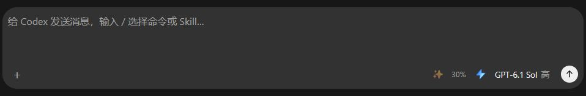

# 远程会话 Fast 闪电开关

日期：2026-11-12。

## 实现结果

- 输入栏模型名称左侧新增独立的闪电按钮。关闭时是灰色空心闪电；开启并保存确认后，是实心蓝色闪电，内部显示蓝色至浅蓝色渐变流光。
- 按用户后续要求，「＋」固定在输入栏最左侧，其余优化、上下文、Fast 和模型按钮整体右对齐，贴近发送按钮；保留原按钮顺序。
- 流光由 18px 图标内部的 CSS 渐变和遮罩实现。2026-11-13 按用户要求放慢为每遍 4 秒，仅播放 1.5 遍：先完整扫过，再扫到中央，约 6 秒后停止并保持中央较亮，不添加 JavaScript 动画定时器。系统启用“减少动态效果”时，直接保留中央较亮的静态渐变和实心形状。
- 桌面点击区为 28px；手机点击区为 32 × 36px，与现有工具栏对齐。闪电与模型按钮间距为 2px，小屏无需负边距，避免点击区重叠。
- 已有会话复用桌面 Fast 的原生会话偏好，切换会话、实例、模型或设备授权后，迟到的读取和保存响应不会改变当前输入区。
- 新会话默认关闭。开启时，首条消息携带本次草稿的明确选择及模型；原生创建回调把选择绑定到实际会话，避免继承桌面上另一个草稿的 Fast 状态。
- 沿用已有 Fast 的账号、管理员、增强设置和模型能力限制。仅在后端报告原生 Fast 接口时展示入口；Claude 不显示该开关，未开放能力的模型不可切换。
- Fast 状态在会话或模型变化后独立异步读取，重复输入重绘不重复请求。已有会话正常发送复用原生偏好，不新增串行设置请求；保存当前会话档位时仅暂缓新消息，停止任务仍可操作。

## 验证

- `node --test scripts/remote-access-ui-state.test.mjs`：336 项通过，包括新增的会话隔离、迟到回执、连点、新建首条和发送边界回归。
- `cargo test -p codex-elves-core --profile release-fast --lib remote_fast_`：2 项通过，覆盖参数、授权、只读、撤权和幂等。
- `cargo test -p codex-elves-core --profile release-fast --test cdp_bridge -- --skip list_targets_can_query_ipv6_loopback_cdp_endpoint`：258 项通过；过滤 1 项既有 IPv6 回环环境测试。
- `npm run check`、`cargo check --workspace --profile release-fast`、`cargo fmt --all --check` 和 `git diff --check` 通过。
- 使用实际远程网页资源和隔离的合成会话预览，验证了桌面及手机布局、开关状态和蓝色填充。手机按钮实际间距约 1.99px，无横向溢出；普通动态设置下动画为 `fast-flow`，减少动态效果下动画为 `none`，静态渐变仍保留。
- 补充布局验收使用 Chrome 扩展和真实输入栏标记、样式的隔离预览：桌面与 320px 窄屏均保持「＋」居左、其余按钮居右；模型按钮与发送按钮间隔 12px，窄屏没有按钮重叠或横向溢出。
- 网页资源修订号为 `2026111261`；原生远程桥接版本为 `148`，Fast 模块版本为 `9`，注入样式版本为 `112`。

## 交付状态

源码和回归验证已完成。本次未连接真实模型发送消息，未更新正式远程服务，未重新构建安装包；已有安装包不包含本次变更。隔离预览进程、浏览器标签页和临时脚本在验证后清理，截图保留为验收记录。
