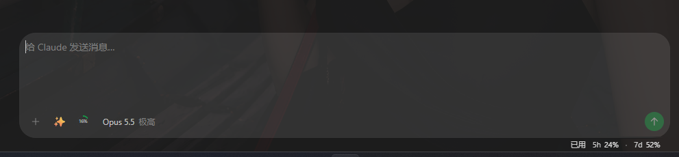
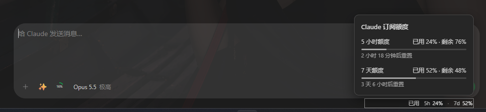

# 历史图片地址失效与定向恢复

日期：2026-11-12。

## 排查结果

用户截图中，19:34 回复里的“默认效果”和“额度详情”都显示“重试图片”。两张原图仍存在于电脑的预览输出目录，大小分别为 67,618 和 71,061 字节，文件写入时间为 19:34:16 和 19:34:17；没有被本次临时文件清理删除。

当前 launcher 于 22:39:13 重新启动。磁盘图片使用随机媒体 ID，注册表仅保存在远程服务内存中；服务重启后，旧 `/api/images/<id>` 不再指向已登记图片。客户端正文缓存仍保留旧 `remoteImages`，原有“重试图片”只是重新请求相同 ID 的缩略图和原图，无法恢复注册。

另一个阻碍在历史合并：为防止迟到历史撤回已完成正文，代码会保留当前条目；这也可能连同已经失效的媒体地址一起保留。因此重新读取历史仍可能留下旧地址。

已确认文件存在、重启时间和上述代码路径。手机诊断报告可以读取，但当次保留的事件中没有图片 HTTP 记录；不能把源码复现当成已直接捕获手机当次 HTTP 状态。

## 修复范围

- “重试图片”通过现有历史接口，按真实会话、轮次、消息和图片来源重新取得登记地址，不增加接受任意磁盘路径的接口。
- 同轮次的在途恢复请求复用；最多查找 12 页，并在重复游标、分页不前进、切换会话或授权变化时停止。
- 仅更新媒体映射，保留正文、完成状态、发送回执与主历史游标。新媒体映射优先于旧缓存和较早发起的历史读取。
- 普通历史同步也能更新已完成条目的图片地址；没有图片的轮次不额外创建媒体映射表。
- 非注入服务模式的指定轮次历史读取透传消息分页游标，避免反复读取第一页。

## 验证与交付

- 现有前端回归 340 项通过，包含新增的完成正文保护、媒体映射更新、旧缓存防回退、定向分页、并发去重和会话／授权切换验证。
- 服务端图片 HTTP 回归通过：清空内存注册表后，原图仍存在，旧原图及缩略图地址均为 404；按原消息重读重新登记后，新地址返回 200，图片字节与原文件一致。文件缺失和撤权仍按原规则拒绝读取。
- 现有服务历史分页回归 2 项通过，包括条目顺序、游标保留与重复游标拒绝。
- `npm run check`、`cargo check --workspace --profile release-fast`、`cargo fmt --all --check` 和 `git diff --check` 通过。
- 网页资源修订号递增至 `2026111262`。未新建测试文件；回归扩展在现有测试文件内完成。

本次不重启正式服务、不重新构建安装包；源码修复需要后续更新程序或网页资源才会生效。

两张原图已按字节复制并校验到固定位置，重新附图可让当前服务登记新的图片地址：

