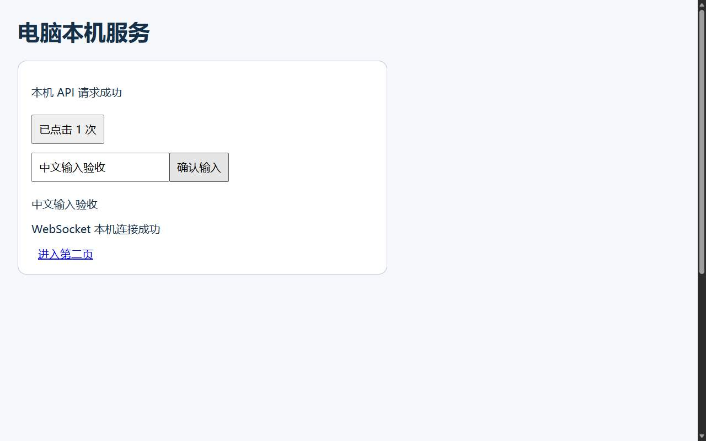
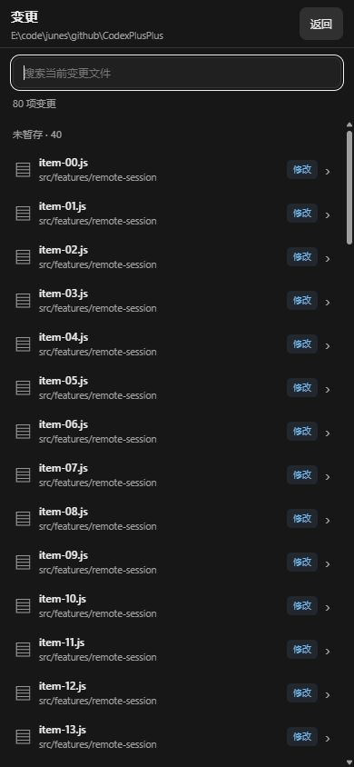
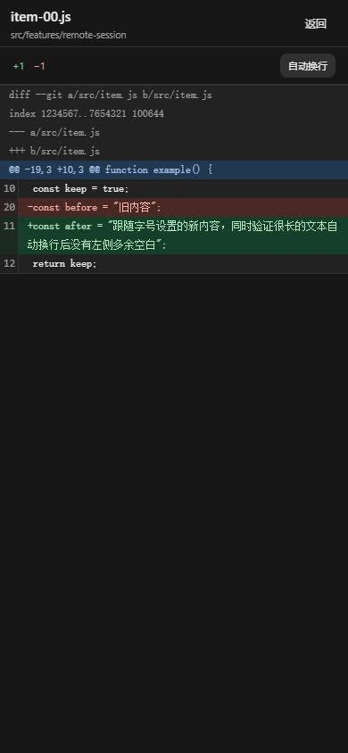

# 远程会话工具验收记录

日期：2026-10-20。结果：源码开发、集成和隔离环境验收完成。

最新交付以文末“浏览器功能移除”为准。用户因当前带宽下体验不佳取消整个浏览器功能；前文的两种浏览器方案及测试均为历史记录，不代表当前仍提供浏览器能力。

## 验收环境与边界

使用当前源码编译独立测试服务，监听随机本机端口。测试适配器提供模拟会话及受信任工作目录；目录内使用真实空 Git 仓库、真实 index 和工作文件，没有创建 Git commit。浏览器由服务启动真实独立 Edge，目标为同机 HTTP 页面，包含绝对路径 fetch、WebSocket、输入框、按钮和页面跳转。

Chrome 插件用于操作远程页面，验证右侧栏、图片预览和截图交互；验证视口包括 1180×860 和 390×844。普通整页截图接口多次超时，未以它作为视觉验收依据；布局以 DOM 尺寸、溢出和可访问状态检查，浏览器画面以实际收到并解码的 JPEG 核对。下图来自新服务的真实浏览器接口，不是侧栏的整页截图。

未构建安装包、未安装、未发布、未替换正式远程服务，未验证 Android 真机及当前正式 Codex 桌面桥接。Android 内置网页资源清单已同步新增模块。

## 自动检查

| 检查 | 结果 |
| --- | --- |
| `cargo check --workspace` | 通过 |
| `cargo test -p codex-elves-core --lib remote_access:: -- --test-threads=1` | 72 通过，0 失败，3 项原有隔离进程或真实 ngrok 测试按规则跳过 |
| 导航修复后的 `remote_access::browser::tests` | 6 通过，含新增导航身份和限定暂态恢复测试 |
| 冲突修复后的 `workspace_conflict_diff_uses_ours_and_standard_two_sided_hunks` | 1 通过，真实多 stage index、无 commit |
| 新增或修改 JavaScript 语法检查 | 通过 |
| 格式与差异检查 | 通过 |
| `/app-resources.json` 中 `session-tools.js` SHA-256 与源码比较 | 一致，清单共 22 项 |

后两项 Rust 专项只重跑受修复影响的范围，不与首轮结果相加声称独立用例总数。

## HTTP 与页面流程

工作区接口的 14 项检查通过：暂存／未暂存／未跟踪分组、index 与工作目录的内容差异、图片前后字节、二进制大小、匿名请求、客户端目录注入、路径穿越、非变更文件、浏览器匿名访问和文件协议拒绝。

浏览器接口的 23 项检查通过：独立设备身份、localhost 地址、桌面与手机 JPEG 实际尺寸、跨设备截图／控制拒绝、点击和中文输入、新帧序号、导航、后退、前进、刷新、滚动和常用按键、坐标越界、任意脚本命令拒绝、只读模式、主动关闭和退出登录。

Chrome 页面实际流程确认：

- 右上角入口打开独立右侧栏，展示六项真实 Git 变更；文本 diff 有行号和增删内容。
- 蓝色 index 图片与绿色工作文件分别出现在修改前后，均解码为 240×140；点击可打开现有图片预览弹窗。
- 390×844 下侧栏宽度为 390，没有页面横向溢出；关闭后保留会话草稿。
- 从 1280×800 切换到 390×844 时，截图和文字输入立即禁用；新 JPEG 解码尺寸匹配后恢复。
- 通过截图点击按钮，电脑端显示“已点击 1 次”；通过文字框输入“手机中文输入验收”，再发 Tab 和 Enter，目标页面显示对应文字。
- 通过目标页面链接进入第二页，远程地址栏和标题同步更新，后退后恢复首页。
- 点击“结束”后显示实例已结束；检查本次状态目录与进程列表，剩余浏览器 profile 和本次浏览器进程均为 0。

## 审查与修复

独立审查发现并闭环两项问题：冲突文件的 combined diff 改为与 stage 2 一致的标准 ours diff；视口切换时禁止使用旧截图坐标，包含普通输入队列满时视口命令仍能入队和失败可重试。

真实浏览器首轮验收发现导航提交竞态：导航请求返回后立即读取历史时，Edge 返回 `Not attached to an active page`。相同参数的对照探针确认等待对应 frame／loader 提交后可读取历史和截图；最终服务按提交事件等待，对历史或截图的该特定暂态错误只做一次有界恢复，不重试写操作。新服务重新编译后通过上述 HTTP 与 Chrome 流程。

本次测试服务、临时测试入口、脚本、仓库和浏览器探针已清理；保留本报告与验收图片。任务前已有 `.playwright-cli/`、`docs/social/` 未改动，代码未暂存或提交。

## 用户验收服务启动

2026-10-20 16:08（北京时间），按用户启动验收的授权执行：

- `cargo build -p codex-elves-manager --bin codex-elves-manager --release` 成功，未构建 Android 或安装包。
- 新服务运行目录为 `C:\Users\junes\.codex-session-delete\remote-access-runtime\tools-20261020-1569139f5af2`，其中保留旧服务回退程序和启动记录；原安装目录未替换。
- 仅切换经管理接口与进程参数核实的独立远程服务，当前 Codex 桌面保持运行。新服务 PID 为 `77032`，本机监听 `127.0.0.1:45222`，原生连接正常。
- 访问密钥配置摘要一致，原有 1 台设备的授权保留。
- 本机 `app.js`、`session-tools.js`、`style.css`、`sw.js` 与当前源码摘要一致。公网 `https://junxin367.shares.zrok.io` 返回 22 项资源清单，`session-tools.js` 摘要一致且请求成功；本机和公网匿名 `/api/session` 均为 `401`。
- 已在 Chrome 打开原公网登录页并保留标签页，供用户使用原密钥验收。没有替用户操作真实项目；Android 真机验收和正式安装包发布仍未执行。

上方“未替换正式服务”的记录对应开发阶段；本节记录随后获授权的验收运行。原安装程序尚未升级，重新启动原安装程序后需再次核对服务版本。

## 菜单与整页交互修正

按用户截图及“返回按钮在右上角”的补充要求，移除了工具侧栏和两个页签，改成四格按钮下拉菜单，以及右侧滑入的完整页面。参考 HAPI 的文件列表、独立详情和返回保留位置的交互，代码在当前项目中自行实现。

本轮使用模拟会话／Git／浏览器 API 和真实 Chrome 操作验证前端，复用此前后端检查，不将模拟接口称为真实 Git 或浏览器执行证据：

- 390×844 下，菜单位于按钮下方，尺寸 180×94，只包含“变更”和“浏览器”；展开菜单不会直接打开功能页。
- 进入时观察到页面从右侧 `x=390` 移至 `x=0`。手机页面为 390×844，返回按钮右缘为 378；桌面页面为 1180×860，返回按钮右缘为 1164。两种尺寸均为完整页面，无横向溢出。
- 变更文件名／目录分层、状态标记、筛选、独立详情、`+2 / −1` 统计与换行开关通过；开启换行后 diff 可视宽度和滚动宽度均为 390。
- 详情返回列表保留搜索内容，列表返回会话保留草稿。图片前后预览及弹窗仍可打开；模拟 Android 返回事件先关闭图片弹窗，仍停留在文件详情。
- 浏览器返回后，间隔采样的截图请求数保持不变，实例仍保留；再次进入无需重新打开。
- 菜单展开后点击原“发送”按钮位置，仅关闭菜单，草稿保留，后端 `send/create` 请求数为 0。
- 独立复核发现新建会话沿用旧 `#thread` 会导致返回旧会话。修正新建根 URL 后，真实页面确认“已有会话 → 新建并填写草稿 → 变更 → 详情 → 列表 → 新建会话”及“浏览器 → 新建会话”均保留新建状态、项目和草稿；继续后退仍可回到原会话。复核已闭环。
- JavaScript 语法、差异检查及管理器 Release 构建通过。Chrome 整页截图接口仍超时，未声称完成像素级截图比对；Android 原生返回在网页事件层验证，未进行真机验证。

2026-10-20 17:02（北京时间），更新后的服务已运行于 `remote-access-runtime/tools-20261020-1ff83bb9b63b`，PID `86248`，原生桌面连接正常。本机和原公网入口的 `app.js`、`session-tools.js`、`style.css` 清单及实际响应 SHA-256 均与源码一致；资源清单仍为 22 项，匿名会话接口保持 `401`，原有授权和密钥保留。

构建前发现工作区同期新增了 `ngrok_tunnel.rs` 的子进程代理环境修复，本任务未编辑该文件。当前工作区构建包含这项改动，其 `ngrok_command_does_not_inherit_proxy_settings` 定向测试通过。旧运行程序保留以便回退，没有安装新版管理器或发布安装包。

## Android 本地浏览器、电脑网络转发及变更页精简

用户明确要求浏览器在客户端渲染、电脑仅打通网络，并选择 Android App 优先。旧截图浏览器代码和 API 已移除；新增 Android 独立进程 WebView、本机 HTTP 代理和授权 WebSocket 字节隧道。代理在电脑解析域名、连接目标，HTTPS 不做中间人解密。浏览器页面不共享控制会话 Cookie 或原生桥，代理失败无 DIRECT 回退。

用户随后要求先调整变更页再生成 App，已按此顺序完成：

- 项目路径位于顶部栏，搜索区固定，无刷新按钮，只有文件列表滚动。390×844、字号设置 14 时文件行高 48px，列表滚动 500px 后搜索框顶部仍为 63px。
- 搜索和 diff 字号由原设置 14 对应的 12px，随设置 20 放大至约 17.1428px。大字号下文件行自然撑高，没有裁切或页面横向溢出。
- diff 内容仅一列有效行号，文件头及 hunk 行无空列，内容从左边缘开始。开启自动换行后内容宽度和滚动宽度均为 390px；新增、删除统计保持 `+1 / −1`。
- 详情返回保留搜索内容和列表位置；回到会话再进入时重新读取变更。以上 UI 使用隔离的 80 个文件数据和真实 Chrome，未替用户操作项目。

验证结果：

| 检查 | 结果 |
| --- | --- |
| `cargo test -p codex-elves-core --lib remote_access:: -- --test-threads=1` | 74 通过，0 失败，3 跳过 |
| 网络隧道定向检查 | 4 项通过，覆盖真实 TCP 二进制回环、地址及帧验证、连接限额、只读／撤销／关闭设备 |
| Android 网址和 HTTP 头解析 | 35 项通过 |
| Android 生产代理类与本机 TLS MockWebServer 联调 | 20 项通过，包含 chunked POST、CONNECT、101、Cookie 隔离、拒绝重定向／不可信证书和持续下行流 |
| 大资源背压 | 5 项通过，2 MiB 完整字节比对、最大队列保持 512 KiB、取消唤醒；修复了慢消费者触发队列满时截断资源的问题 |
| Android Java 编译及 lint | 通过；Release lint 为 0 错误、5 警告（允许目标 HTTP 的配置说明及 4 项既有 UI 告警） |
| 原生桥与网页分支模拟 | 成功／失败／超时清理通过；Android 成功不生成多余 HTML 层级；普通网页明确提示使用 Android |
| 独立集成复核 | PASS，无已确认阻断；Android 真机行为仍待验收 |

2026-10-20 18:24（北京时间），电脑端服务已更新至 `remote-access-runtime/network-20261020-575a9c5ba405`，PID `102384`；运行程序 SHA-256 为 `575A9C5BA40585D787705711893D209CED33E621C3EC0513D8582B1F18D70976`。原生会话连接正常，原有 3 台设备授权及访问密钥保留，旧运行文件保留用于回退，原安装目录未替换。

真实服务的 `/api/browser/tunnel` 已通过授权 WebSocket 访问电脑 `localhost` 测试服务，得到 HTTP 200 及专用测试标记；电脑未启动浏览器。已授权请求旧 `/api/browser/open` 返回 404，匿名会话和隧道接口均返回 401。本机及原公网入口的 22 项资源清单版本相同，`app.js`、`session-tools.js`、`platform.js`、`style.css` 的响应摘要与源码一致。

用户已明确授权生成验收 APK。按仓库入口执行 `scripts/build-android.ps1 -Configuration Release`，使用既有正式签名，Release 构建及 lint 成功；没有调整版本或创建新证书。产物：

- 路径：`dist/android/CodexElves-0.0.2-android.apk`
- 版本：`0.0.2`，`versionCode=4`
- 大小：`2484943` 字节
- SHA-256：`3A4F2C82A160D579065F58CAD7724B86B698893C7B4FEC6EFE1F5993FA613EE8`
- APK v2 签名验证通过；签名证书 SHA-256：`7b15895625b40e03792fc250a1fc489df11fe03a25f7e8f1e177d2442fe9dc2d`
- APK 内置 `app.js`、`session-tools.js`、`platform.js`、`style.css` 与清单及当前源码的 SHA-256 一致；本机更新清单的大小和摘要匹配。

交付边界：已构建未发布，未安装 APK、未运行 Android 真机或模拟器验收。新网络浏览器需要更新 App，旧 App 无法仅靠网页热更新获得原生能力；Android 9 以下或缺少所需 WebView 代理能力时给出提示。本次没有提交、推送、发布标签或安装 Windows 管理器。

清理情况：Android 子任务临时夹具已删除；本轮 Chrome 验收标签页已关闭、视口覆盖已恢复，本机测试 HTTP 服务已通过自身停止接口关闭。`temp/browser-minimal-20261020` 的清理经核实无重解析点、无引用进程且启动记录已另存，但自动审批仍返回 `blocked by policy`，因此保留该目录及本轮旧方案预览图，未继续绕过删除限制。

## 浏览器功能移除

用户反馈当前带宽下浏览体验不佳，明确要求删除整个浏览器功能。已移除网页菜单项目、原生桥及状态、Android 浏览器与代理类、动画资源、OkHttp 依赖、电脑端 `browser.rs`、隧道路由和连接注册表。Android Manifest、MainActivity 与网络安全配置恢复至添加该功能之前，保留原会话 WebView、通知、更新及附件行为；禁止明文流量的策略已恢复。

“变更”功能保留：菜单、滑入页面、顶部路径、固定搜索、跟随设置的字号、紧凑列表、单列 diff 行号、图片预览及返回位置恢复均未撤回。`session-tools.js` 继续进入网页和 APK 资源清单。

验证：

- JavaScript 语法、浏览器专用符号扫描及差异检查通过。
- 工作区读取 12 项测试、工作目录身份测试和资源／接口边界测试均通过，共 14 项。
- Windows 管理器 Release 服务程序构建通过。
- 正式签名 Android Release 构建及 lint 通过，0 错误、4 项既有 UI 警告；APK v2 签名验证通过。
- APK Manifest 不含原生浏览器 Activity 或 Application 类，`usesCleartextTraffic=false`；无浏览器动画及 OkHttp 元数据。内置 `app.js`、`session-tools.js`、`platform.js`、`style.css` 摘要与当前源码一致。

2026-10-20 18:55（北京时间），独立验收服务已切换至 `remote-access-runtime/changes-only-20261020-c216cf559ce9`，PID `106624`，原生连接正常，原有 3 台设备授权与密钥保留。运行程序 SHA-256：`C216CF559CE9AB4AE97E0624FE0243E3CA1804D6B9BB5E3BAABDD5B31829A0C6`。

已授权设备访问旧 `/api/browser/tunnel` 返回 404，同一设备 `/api/session` 返回 200；匿名会话请求继续返回 401。本机与原公网入口的 22 项资源清单一致，版本为 `90a8d2a58130f4c555d099c9a69f055825c095dd633131e2f55887baa99bec35`。四份前端资源均与源码匹配，菜单只有“变更”。

本次重新生成的验收 APK 取代上节包含浏览器的本地产物：

- 路径：`dist/android/CodexElves-0.0.2-android.apk`
- 版本及 versionCode：`0.0.2`／`4`，未递增。
- 大小：`2324484` 字节。
- SHA-256：`072203F35CA9C0EC389570A465094FDBCB608E7CE07C47E0974EBAB286DCE618`。

未安装到手机、未发布、未提交或推送；保留不属于本次功能的工作区修改和上一节已记录的临时文件。

## 变更分组折叠与 App 缓存

按用户补充要求，已暂存、未暂存、未跟踪三个分组可点击展开或收起，默认展开，支持 Enter 和 Space。展开状态、筛选、滚动位置和 diff 换行设置按设备授权及会话／项目隔离保存；筛选期间单独管理折叠状态，清除筛选后恢复原分组状态。

列表与文件详情复用 App 的 IndexedDB 只读缓存。进入页面先显示缓存，再后台携带 `ifRevision` 核对；未变化时保留原 DOM 和图片，不重新传输正文。每次打开详情都独立核对内容版本，即使文件状态仍为 `M`，新的 diff 也会更新。服务端继续读取当前 Git 状态并复核授权、目录和路径，不引入文件监听或服务端持久缓存。

普通网络错误保留缓存并显示“正在显示上次缓存”；授权失效、目录失效、文件已不在变更列表等明确失效情况会清理相应缓存。持久缓存沿用整体 32 MiB、单条 6 MiB、64 条和默认 7 天的限制；内存复用总量限制为 16 MiB。冷读取等待至多 750ms，迟到结果按授权、目标及请求代次校验，不能覆盖较新内容或页面状态。

### 浏览器与 IndexedDB 验证

使用隔离的模拟工作区接口和真实浏览器、IndexedDB 验证，不将模拟数据当作真实 Git 读取证据：

| 场景 | 结果 |
| --- | --- |
| 分组点击、Enter、Space | 可展开和收起，`aria-expanded` 与实际显示一致 |
| 折叠状态持久化 | 页面重载后“未跟踪”仍保持收起 |
| 滚动恢复与固定搜索 | 重载后恢复至 450px，搜索框顶部仍为 68.421875px |
| 会话／项目隔离 | project-b 默认展开，切回 project-a 恢复其收起状态 |
| 列表版本确认 | 首次 2081 字节，未变化时 135 字节 |
| 文本差异版本确认 | 首次 19990 字节，未变化时 135 字节；原 diff DOM 节点复用 |
| 图片版本确认 | 首次 592 字节，未变化时 135 字节；图片节点复用，`srcWrites=0` |
| 相同文件状态下内容变化 | 状态保持 `M`，内容从版本 A 更新为版本 B |
| 503 网络故障 | 原 diff 保留，显示缓存与网络暂时不可用提示 |
| 冷启动缓存读取 | 一次实测 410.5ms，有效命中；不作为手机性能承诺 |
| 390×844 布局 | 无页面横向溢出，固定搜索、紧凑列表和单列行号保持 |

定向检查：工作区读取及版本协商 16 项测试通过；工作目录身份与条件版本格式测试 1 项通过；JavaScript 语法检查通过。独立复核已闭环列表请求代次、授权切换后的迟到 401、缓存容量淘汰、冷读取与偏好覆盖四项问题，最终结果 PASS。

### 运行服务与真实工作区验证

2026-10-20 20:24（北京时间），独立验收服务已切换至 `remote-access-runtime/changes-cache-20261020-4abb3c885c08`，PID `87628`，原生桌面连接正常，原有 3 台设备授权和访问密钥保留。运行程序 SHA-256：`4ABB3C885C083D57D2107C76A47F1662ED58D523B313F5B79499A190826943DC`。旧运行文件保留作回退，原安装目录未替换。

本机 `http://127.0.0.1:45222` 与公网 `https://junxin367.shares.zrok.io` 的资源清单均含 22 项，版本均为 `2c9269a243c6cc36ab927ca92f00f39968228d316752fa335466110679a53903`。`app.js`、`session-tools.js`、`recovery-store.js`、`style.css` 的清单及响应 SHA-256 均与源码一致；匿名会话接口均返回 401。

20:30 使用短期验收登录对当前真实会话工作区进行只读验证：列表全量 1735 字节，条件请求 163 字节；`recovery-store.js` 文本差异全量 1189 字节，条件请求 163 字节。两次条件请求均返回 `notModified:true`，省略列表或 diff 正文，并保留 `Cache-Control: no-store`。确认响应大小随仓库路径长度变化，不固定为隔离验收中的 135 字节。已授权会话接口返回 200，已移除的浏览器隧道接口返回 404；验证后已撤销临时验收授权。

### Android 验收包

按已有“调整完再生成 App”的授权，重新执行 `scripts/build-android.ps1 -Configuration Release`。正式签名构建及 lint 成功，0 错误、4 项既有 UI 警告；APK v2 签名验证通过。内置 `app.js`、`session-tools.js`、`recovery-store.js`、`style.css` 与源码摘要一致，本机更新清单的大小和 SHA-256 匹配。

- 路径：`dist/android/CodexElves-0.0.2-android.apk`
- 版本及 versionCode：`0.0.2`／`4`，保持不变。
- 大小：`2330816` 字节。
- SHA-256：`375C13571D71904823051EAAA244C3F789CE079FBA2F4E520A075173D83D2F99`。

此包取代上一节仅移除浏览器功能的本地产物。状态为已构建未发布，尚未安装到手机或进行 Android 真机验收；未提交、推送或创建发布标签。

收尾：临时 QA 服务 `127.0.0.1:57150` 已通过自身停止接口退出，浏览器验收页已关闭，视口覆盖已恢复。删除 `temp/change-cache-20261020` 的操作被自动审批以 `blocked by policy` 拒绝，未执行或绕过；该目录及此前已记录的 `temp/browser-minimal-20261020` 仍保留。
